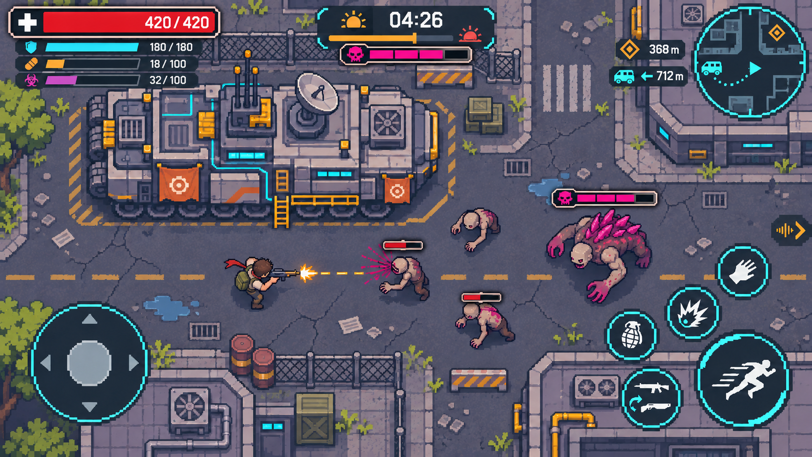

# 08｜UI、画面、音频、引导与移动端体验

> 版本：1.1
>
> 视觉基准：正交俯视平面精细像素，主玩法 UI 图已确认

## 1. 体验目标

表现层服务三个核心目标：

1. 大规模尸潮中仍能一眼找到角色、特殊怪和方舟受损点。
2. 复杂成长系统在手机横屏上可以快速理解和操作。
3. 昼夜、污染和方舟进化拥有鲜明的视听身份。

设计基准分辨率为 1334×750。画面允许横向扩展到更宽比例，关键操作与信息必须放在安全区内。

当前确认的主玩法 UI 以本图为唯一视觉基准；后续探索、夜战、BOSS 与整备界面均沿用其视角、像素密度、色彩语义和组件样式：

## 2. UI 信息优先级

### 一级：立即影响生存

生命、护盾、污染、日落倒计时、方舟核心、特殊怪预警、翻滚和技能状态。

### 二级：影响当前决策

背包空间、路线、目标、模块耐久、供电、噪音、波次进度。

### 三级：长期成长

装备词条、科技、幸存者、图鉴、任务详情和历史统计。

一级信息常驻；二级信息按阶段或上下文显示；三级信息进入独立界面，禁止覆盖战斗视野。

### UI 视觉基准

- 画面使用横屏正交高位俯视视角，可见角色、怪物头顶和肩部以及方舟顶部模块。
- UI 面板使用深蓝黑底、2–3 px 像素描边和科技青外轮廓；不使用玻璃拟态、写实金属或立体高光。
- 玩家生命使用高对比红色主条与白色医疗图标，尺寸显著大于护盾、伤势和污染条。
- 普通敌人仅在受伤或被锁定时显示短红色血条；特殊感染者显示分段洋红血条和精英图标。
- 当前锁定的特殊感染者在顶部时间条下方同步显示一条紧凑目标血条。
- 小地图为右上圆形雷达；触控按钮为深色圆底、科技青描边和高对比白色图标。
- 警戒橙只用于时间、危险方向和需要立即处理的状态，不能作为普通装饰色。

## 3. 界面状态栈

界面按栈管理：

- 游戏 HUD 为底层。
- 地图、背包、布局和暂停作为覆盖层压入。
- 确认弹窗位于当前界面之上。
- 返回键只关闭最上层界面。
- 进入新阶段时清理不再有效的临时覆盖层。

不能用多个相互独立的布尔值控制暂停、背包、地图和弹窗，否则容易出现输入穿透和返回逻辑冲突。

## 4. 主界面与方舟总览

主界面以方舟顶部模块总览为中心，保持与战斗一致的正交俯视视角，直接看到已安装模块、供电线路和幸存者活动。核心入口围绕方舟布置：

- 出发：开始白天探索。
- 装备：角色方案和仓库。
- 工坊：制造、强化、改装、拆解。
- 建设：方舟模块与供电。
- 研究：天赋、科技和活体进化。
- 成员：岗位、士气和个人任务。
- 情报：地图、天气、尸潮趋势和任务。

主界面顶部只常驻章节、天数、金币和三种当前最相关材料；其余资源在仓库或对应界面显示。

## 5. 白天探索 HUD

- 左上：生命、护盾、伤势图标、污染环。
- 顶部中央：白昼时间条，最后两分钟转为分段警戒。
- 右上：小地图、方舟方向、当前目标和距离。
- 左下：移动摇杆。
- 右下：翻滚、两个技能、换枪、上下文互动。
- 下方中央：当前武器、弹匣或热量、备用武器状态。
- 屏幕边缘：特殊怪、求救、撤离方向和高价值掉落提示。

血条按重要性分级：

- 玩家生命条位于左上并保持最大视觉权重，红色填充、浅色轮廓和数值同时显示。
- 护盾、伤势和污染位于主生命条下方，尺寸更小、明度更低，但颜色语义固定。
- 满血普通敌人不常驻显示血条；受伤或被锁定时在头顶显示短红条。
- 特殊感染者显示分段洋红血条和精英图标；当前锁定目标在顶部中央同步显示目标血条。
- BOSS 使用阶段血条，但不能遮挡白昼时间、波次或核心耐久信息。

## 6. 夜间防守 HUD

- 顶部中央：方舟核心耐久、波次进度、剩余威胁。
- 左侧：受损模块队列，只显示最严重的三项。
- 右侧：应急供电、主动设施和维修操作。
- 画面内模块：耐久低于阈值时出现世界空间图标。
- 特殊怪突破防线时同时使用语音、方向标和短促屏幕边缘警示。

喘息期自动展开简化维修条，但不强制打开完整布局界面。

## 7. 方舟布局界面

布局界面分为模块栏、方舟槽位区、属性预测区：

- 拖动模块时显示可用槽位、射界、供电和相邻关系。
- 放置前预览总耗电、总噪音和预计停机模块。
- 不合法放置使用红色轮廓、图标和短文本说明。
- 支持撤销最近一步和恢复进入界面前布局。
- 支持三套命名方案。

触屏拖放必须提供 8–12 像素的吸附容差，松手后自动落在最近合法槽位。

## 8. 装备与仓库

装备比较页优先展示：

1. 核心特性和进化方向。
2. 伤害、射速、换弹、射程等武器身份参数。
3. 标签共鸣变化。
4. 详细词条。

属性变化用数字、箭头和颜色共同表示。绿色和红色不能作为唯一差异手段。仓库支持类型、品质、标签、元素、收藏、可进化和方案占用筛选。

## 9. 响应式与安全区

- 参考分辨率：1334×750。
- 支持 16:9、18:9、19.5:9 和 20:9。
- 世界画面向横向扩展，HUD 锚定安全区边缘。
- 关键按钮距离物理边缘保留安全间距。
- 弹窗和核心菜单限制最大宽度，超宽屏不无限拉伸。
- 长文本区域使用可滚动容器，不缩小到无法阅读。

UI 使用锚点和容器布局，不使用只适配单一分辨率的绝对坐标。

## 10. 移动端触控规范

- 常用战斗按钮建议不小于 72×72 设计单位。
- 主要按钮之间保留至少 12 设计单位空隙。
- 默认使用固定左摇杆，保证肌肉记忆；跟随摇杆只作为可选设置。
- 玩家可调整按钮大小、透明度和位置。
- 危险确认不放在高频战斗按钮附近。
- 长按只用于预览、批量和非紧急操作。
- 手指按住技能时显示范围，滑出按钮区域取消释放。

## 11. 可访问性

- UI 缩放提供 100%、125%、150%。
- 提供色弱图标方案。
- 伤害数字可设为完整、精简、关闭。
- 震屏、闪光、动态模糊和手柄振动可调。
- 字幕支持背景、说话者名称和字号。
- 关键状态同时使用颜色、形状、图标和声音。
- 自动射击可选择“有目标时射击”或“持续射击”。

## 12. 视觉方向

### 总体风格

采用“工业废土＋生物机械＋高识别色”的正交高位俯视 2D 精细像素风。画面必须能看见角色和怪物头顶、肩部与地面站位，方舟展示顶部模块、炮塔和能源线路。场景使用扁平色块、3–5 级明暗和清晰像素簇塑造体积，不追求 3A 材质、体积雾或电影级写实光照。

场景不出现天空和地平线，不使用横版侧视或等距菱形视角。空间层次主要来自地面分区、建筑屋顶边缘、阴影方向和少量平面遮挡，而不是透视汇聚或景深模糊。

### 形状语言

- 人类与方舟：方形、楔形、机械连接、明确承重结构。
- 普通尸群：破碎、不对称、前倾轮廓。
- 特殊感染者：夸张攻击器官，职能由轮廓直接表达。
- 生化进化：柔软曲线、脉动、半透明组织，与硬机械形成对比。

### 色彩角色

- 环境基础：低饱和灰蓝、锈褐、脏绿。
- 可交互物：暖黄或冷青高亮。
- 玩家与友军：青白和稳定蓝。
- 常规危险：橙红。
- 污染与异变：紫红和酸性荧光绿。
- 电力：高亮蓝白。

## 13. 画面层级

从下到上：

1. 道路、地砖、水面和污染区等地面底层。
2. 车辙、裂缝、道路标线、污渍和低矮杂物。
3. 建筑屋顶边缘、围栏、方舟、箱体和可碰撞设施。
4. 角色、怪物、掉落与交互物。
5. 弹道、攻击范围、天气和局部粒子。
6. 世界空间血条、方向提示和 HUD。

高墙、屋檐和方舟模块不能长期遮住角色。角色进入遮挡区时，遮挡物透明度自动降低或显示角色青色轮廓。

## 14. 动画与特效

- 角色移动覆盖八方向，头部、肩部、武器朝向与脚步方向保持一致；武器后坐与身体动画分层。
- 特殊怪攻击至少包含预备、释放、恢复三个阶段。
- 炮塔开火、过热、停机和寄生必须有不同状态动画。
- 受击闪白只用于短瞬间，不能覆盖怪物职能颜色。
- 大规模尸潮减少单体高成本粒子，使用批量尘土、血雾和集群效果。
- BOSS 技能范围先用地面和姿态预警，再播放高亮特效。

## 15. 音频总线

音频总线结构：

- Master
- Music
- SFX
  - Weapon
  - Enemy
  - Ark
  - Environment
- Ambience
- UI
- Voice

所有声音必须进入明确总线。设置界面提供主音量、音乐、音效、环境和语音控制。

## 16. 混音目标

- 移动端代表性流程综合响度目标约 -18 LUFS，允许小范围浮动。
- 真峰值不高于 -1 dBTP。
- 特殊怪预警、角色受击和方舟核心警报拥有最高瞬时优先级。
- 语音播放时音乐和环境声短时压低，不能覆盖玩家设置的音量值。
- 同屏枪声过多时限制同类声音复音数，保留节奏而非叠加失真。

## 17. 自适应音乐

音乐使用分层和段落切换：

### 白天

环境底层、探索节奏层、危险脉冲层。进入高危区或日落临近时逐步增加层次。

### 黄昏

使用固定警报动机和方舟启动声完成阶段转换。

### 夜晚

基础节奏、尸潮层、特殊威胁层、高潮层。根据尸潮阶段在小节边界切换。

### BOSS

每个阶段拥有独立层或段落，失衡窗口使用短促音乐标记，不因普通暂停重新从头播放。

## 18. 音效规范

- 同类脚步、枪声尾音、近战命中至少准备 3–5 个变体。
- 随机音高控制在轻微范围，不能改变武器身份。
- 特殊怪在入场前播放独立远距离预警。
- 方舟模块有工作、受损、过载、停机、寄生五种可辨声音状态。
- UI 确认、取消、警告、稀有掉落和任务完成使用不同音型。
- 高频重复提示设置冷却，避免语音和警报轰炸。

## 19. 新手引导

| 天数 | 引导内容 | 解锁界面 |
|---:|---|---|
| 第1天 | 移动、自动射击、拾取、返程 | 基础 HUD、简化背包 |
| 第1夜 | 炮塔、方舟核心、维修 | 防守 HUD |
| 第2天 | 宝箱风险、背包取舍、伤势 | 完整背包 |
| 第2夜 | 供电切换、特殊怪 | 简化供电 |
| 第3天 | 制造、词条、换枪 | 工坊和装备比较 |
| 第3夜 | 多方向防守、喘息维修 | 防守方案 |
| 第4–5天 | 幸存者、尸巢、动态地图 | 成员与情报 |
| 第5夜 | 精英词缀和弱点 | 图鉴 |
| 第6天 | BOSS 削弱、进化预览 | 研究 |
| 第7夜 | BOSS、章节迁徙 | 完整方舟总览 |

教学遵循“安全展示 → 玩家实践 → 压力检验”。同一时刻只要求学习一个新输入或一个新界面。

## 20. 中断与恢复

- 应用进入后台时立即暂停并保存轻量恢复点。
- 回到前台先显示暂停遮罩，不直接恢复战斗。
- 来电、录屏权限和平台弹窗不会继续消耗白昼时间。
- 崩溃恢复优先回到最近完整阶段快照，不能加载半结算状态。
- 下载或加载失败时提供重试和返回主界面，保留有效存档。

## 21. 性能与电量体验

- 默认目标 60 FPS，低端模式目标稳定 30 FPS。
- 提供标准和省电两档画质。
- 省电模式减少粒子、尸体停留、视差层和伤害数字，不改变敌人数值。
- 设备过热或长时间低帧时提示切换省电模式，不在战斗中自动改变操作灵敏度。

## 22. 表现验收

- 16:9 至 20:9 下关键 HUD 不被裁切。
- 单手遮住任意一个屏幕角时，仍可通过其他反馈识别重大危险。
- 特殊怪预警在嘈杂战斗中仍可听见并看见。
- 新玩家在第三天前不需要同时理解全部系统。
- 方舟每次阶段升级都具有明显轮廓变化。
- 音量设置影响对应总线，不存在绕过设置的声音源。
- 主玩法始终保持正交俯视，角色与怪物头顶可见，不出现横版侧视、天空或地平线。
- 玩家红色主生命条在一秒内可识别；受伤普通敌人和特殊感染者的血条层级清楚且不遮挡战斗。
