# 12｜UI 效果图

> 版本：1.3
>
> 状态：视觉方向已确认，用于界面布局、美术生产和客户端实现参考

## 1. 统一视觉规则

- 横屏正交高位俯视 2D，角色、怪物和方舟顶部结构清晰可见。
- 平面精细像素，不使用横版侧视、等距菱形视角或 3A 写实材质。
- UI 使用深蓝黑底、2–3 px 科技青描边、高对比白色图标。
- 玩家生命使用高权重红色主条；感染与精英使用洋红；警戒和选择使用橙色。
- 夜晚角色只在方舟顶部防守平台或内部作战，不在庇护所外战斗。
- 维修由方舟远程系统和自动维修无人机执行，不展示角色手动维修。

## 2. 主玩法效果图

### 2.1 白天探索

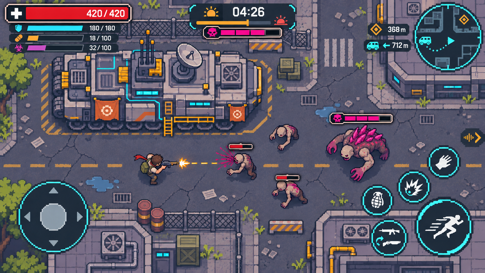

验证重点：玩家状态、白昼时间、锁定目标、小地图、双拇指触控和敌人血条层级。

### 2.2 夜间方舟防守

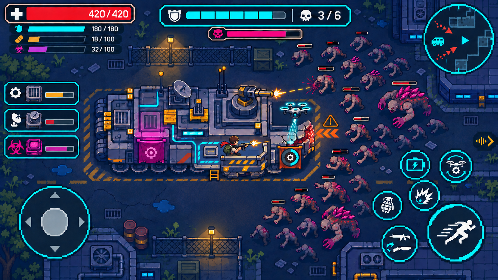

验证重点：玩家位于方舟顶部战斗平台；方舟核心、波次、模块受损、远程维修和多方向尸潮同时可读。

### 2.3 黄昏方舟整备

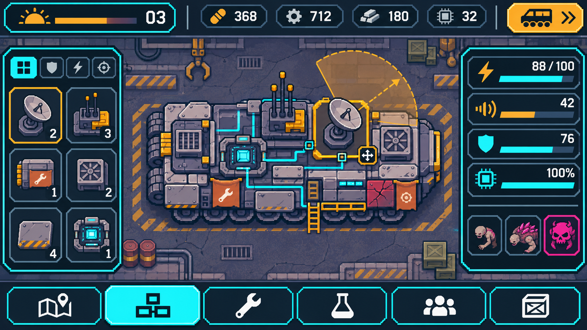

验证重点：模块拖放、射界、供电线路、损坏状态、方舟属性和次夜威胁预览。

## 3. 成长与装备效果图

### 3.1 装备与仓库

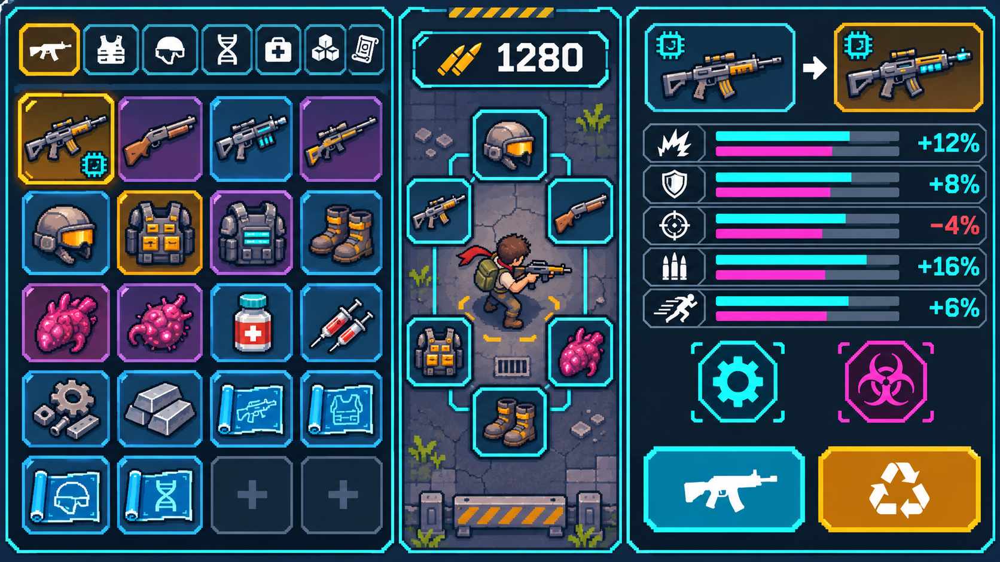

验证重点：仓库筛选、角色装备槽、物品比较、标签属性、装备与回收操作。

### 3.2 进化选择

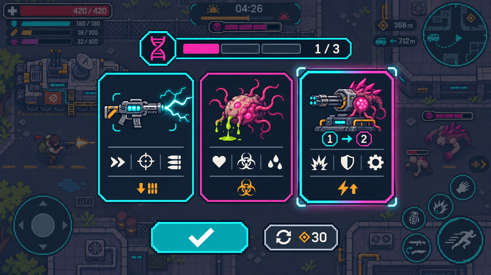

验证重点：机械、生物和混合三条路线的身份差异、收益与代价、选中状态和确认操作。

## 4. 功能模块效果图

### 4.1 世界地图与探索情报

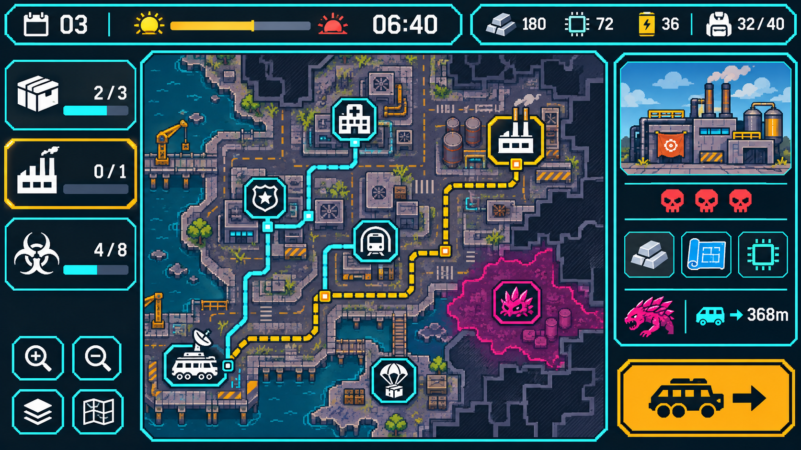

验证重点：白昼剩余时间、背包空间、路线、地点风险、奖励倾向、污染区与方舟距离可以在出发前快速判断。

### 4.2 工坊制造与改装

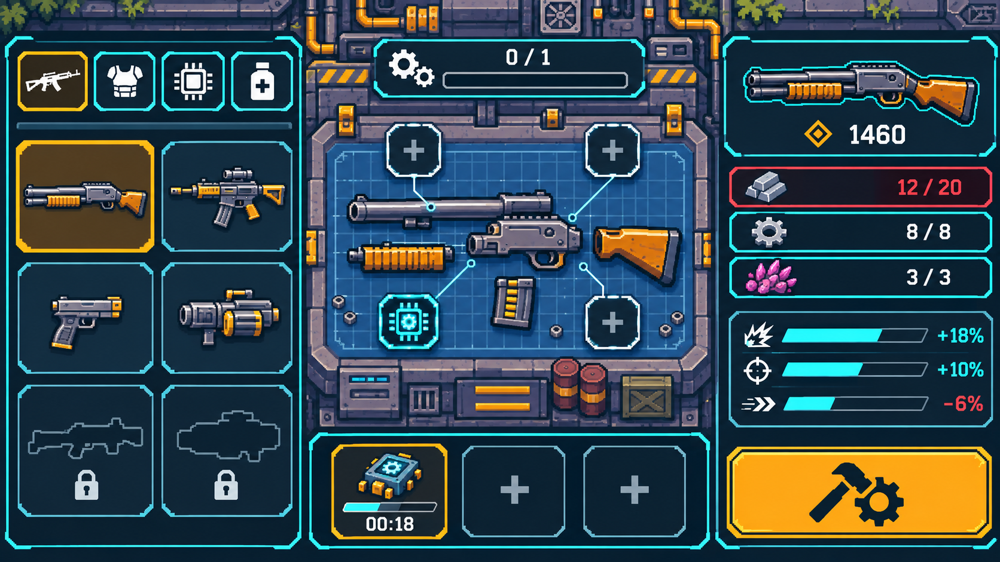

验证重点：配方选择、拆解结构、改装插槽、材料缺口、产出属性和制造队列使用同一视觉层级。

### 4.3 幸存者与岗位管理

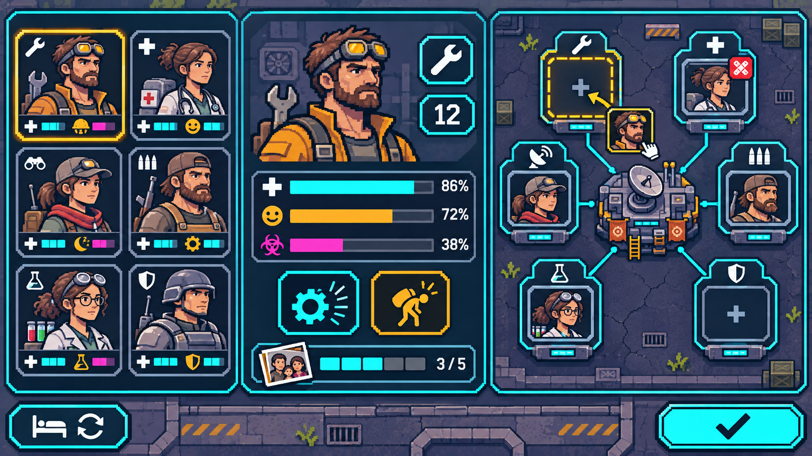

验证重点：成员职业、健康、士气、疲劳、特质、个人任务和方舟岗位拖放关系一屏可读。

### 4.4 研究与科技树

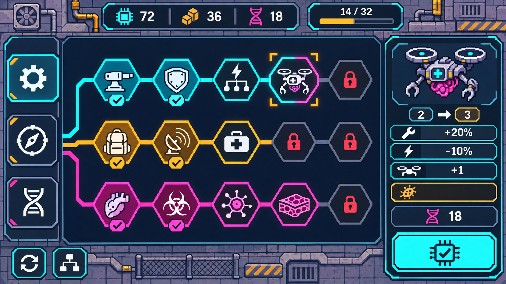

验证重点：机械防御、生存运营和生物进化三条路线拥有稳定色彩身份，前置关系、可研究状态、效果和副作用清晰。

### 4.5 方舟主界面

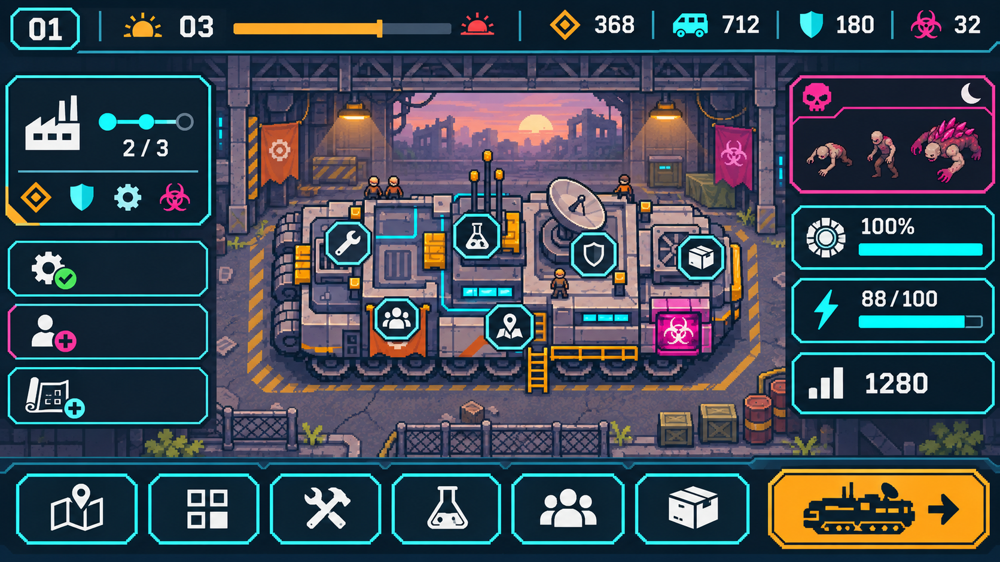

验证重点：方舟状态、资源、当前目标、成员通知、次夜情报和六个核心功能入口围绕同一俯视方舟组织。

### 4.6 任务与事件详情

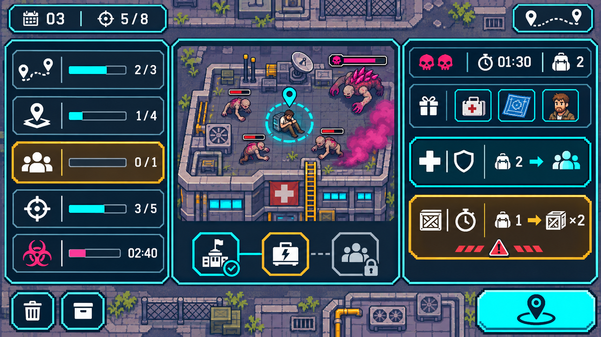

验证重点：任务类型、当前步骤、现场态势、风险、预计耗时、奖励和事件处理选择无需长文本即可理解。

### 4.7 每日结算

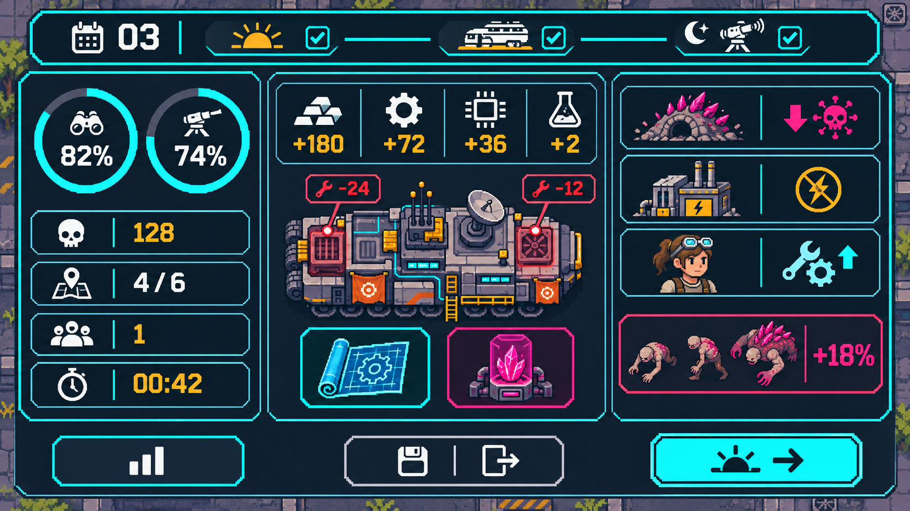

验证重点：探索表现、夜战表现、资源收益、方舟损坏和次日区域变化分区明确，安全退出入口清晰。

### 4.8 BOSS 方舟防守

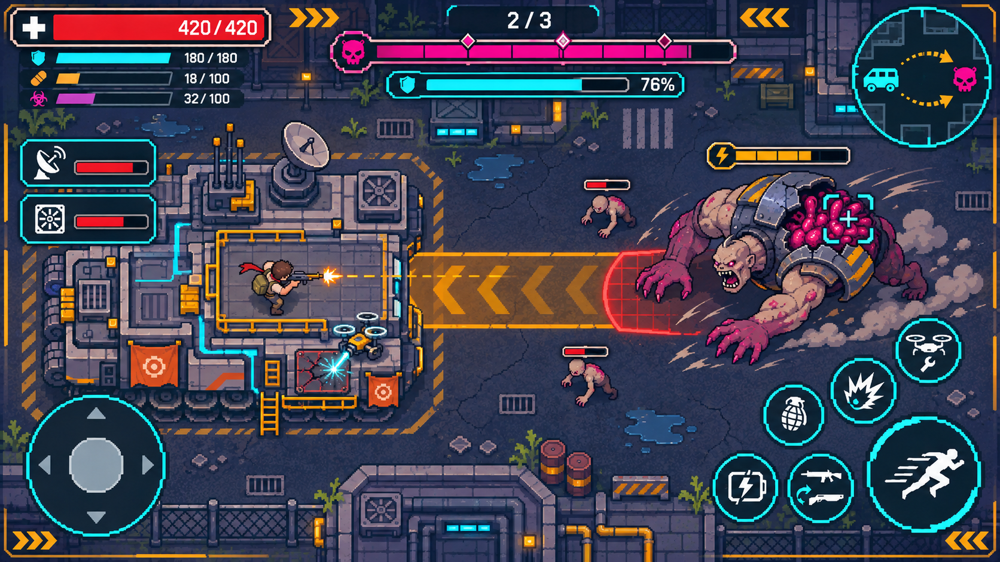

验证重点：玩家始终位于方舟顶部防守平台；BOSS 阶段、弱点、冲撞范围、方舟核心和自动维修同时可读。

### 4.9 暂停与触控设置

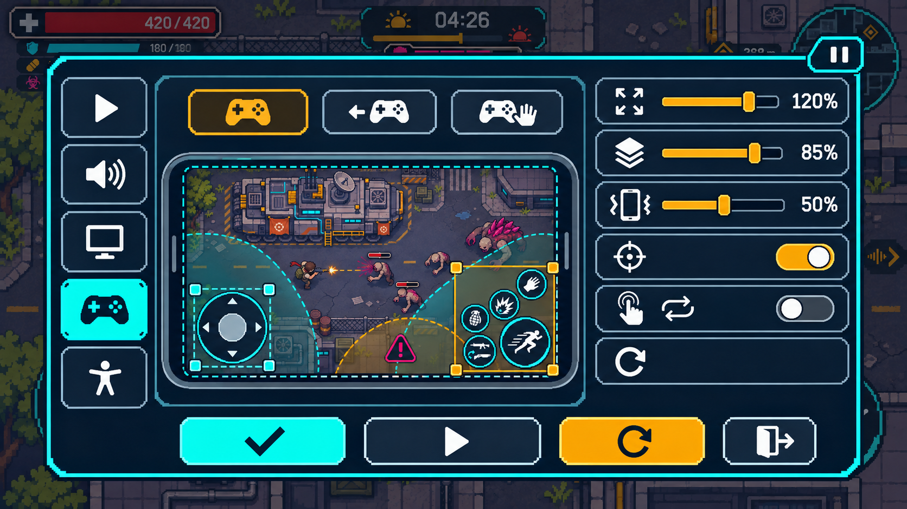

验证重点：暂停态保持战斗上下文；触控布局、安全区、左右手预设、按钮大小、透明度和辅助操作可直接预览。

### 4.10 章节迁徙

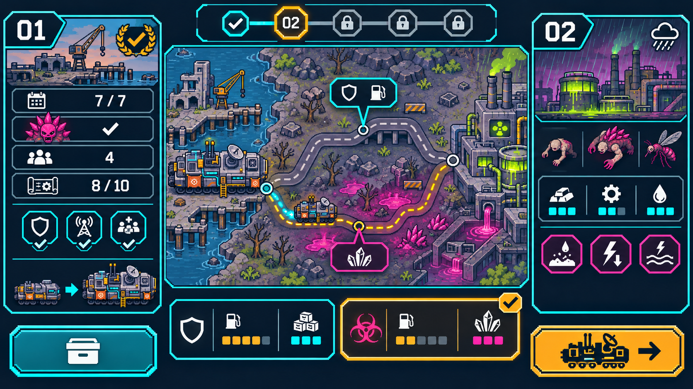

验证重点：本章成果、方舟升级、下一地区规则和安全/高风险路线取舍在迁徙前集中确认。

### 4.11 失败复盘与重试

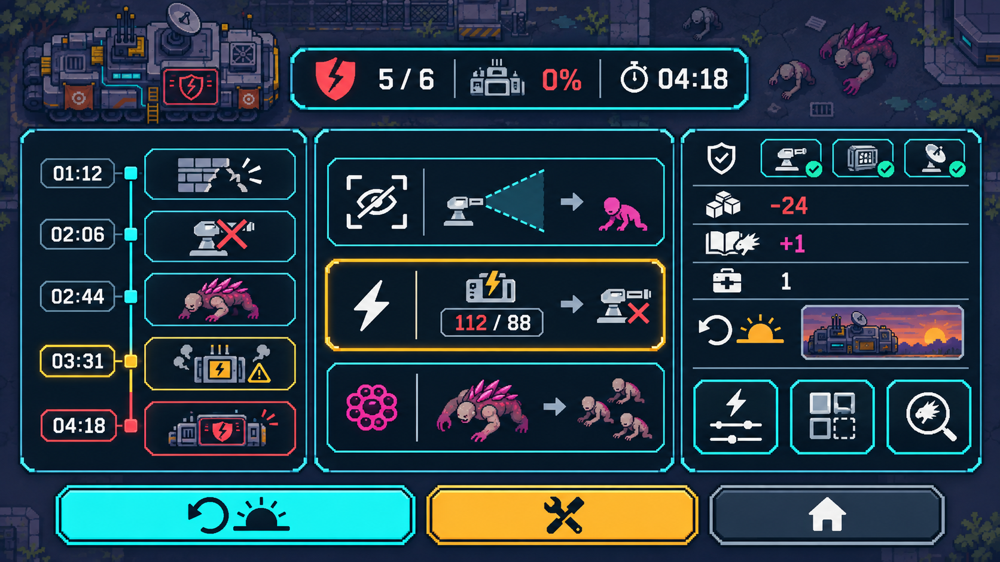

验证重点：用事件时间线和因果图指出供电、布局或敌人机制问题，并提供黄昏快照重试和调整入口。

### 4.12 幸存者对话与选择

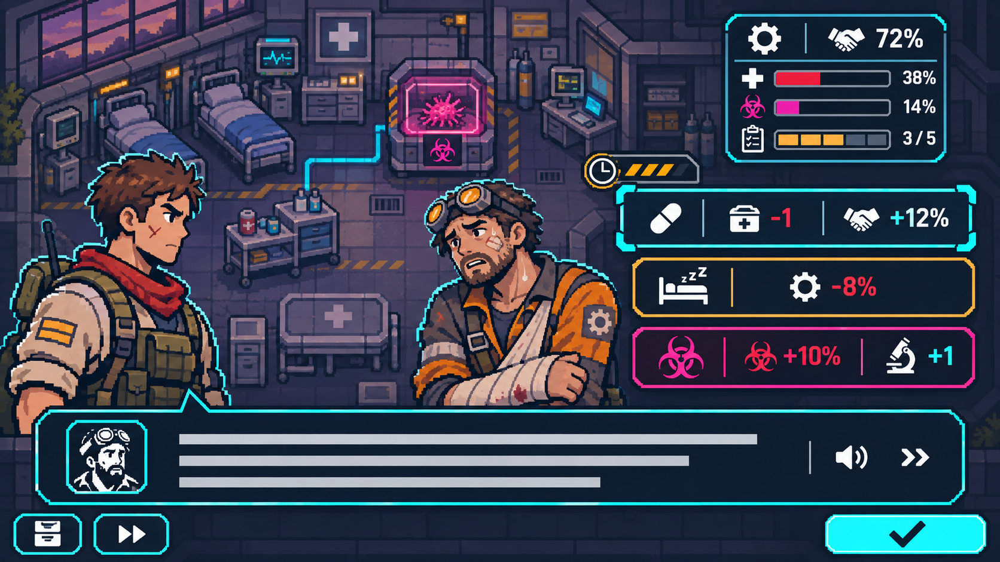

验证重点：成员状态、情绪、个人任务、选项成本和后果清楚；维持末世生存语气，不转为恋爱模拟界面。

## 5. 使用边界

效果图用于确认视觉系统、信息层级和布局方向，不直接作为最终切图。正式实现必须根据安全区、字体授权、触控热区、数据长度和多语言需求重建组件。

## 6. 生成记录

- 生成方式：Codex 内置 imagegen。
- 生成日期：2026-11-02。
- 统一参考：`ui-main-gameplay-topdown-v1.png`。
- 提示词组：白天俯视探索、方舟顶部夜战与自动维修、黄昏模块布局、装备比较、三路线进化、区域地图情报、工坊制造、幸存者岗位、三路线科技树、方舟主界面、任务事件、每日结算、方舟顶部 BOSS 战、暂停触控设置、章节迁徙、失败复盘、幸存者对话。
- 资产状态：界面概念效果图，仅用于方向确认；正式组件需要在 Cocos Creator 中重建。
