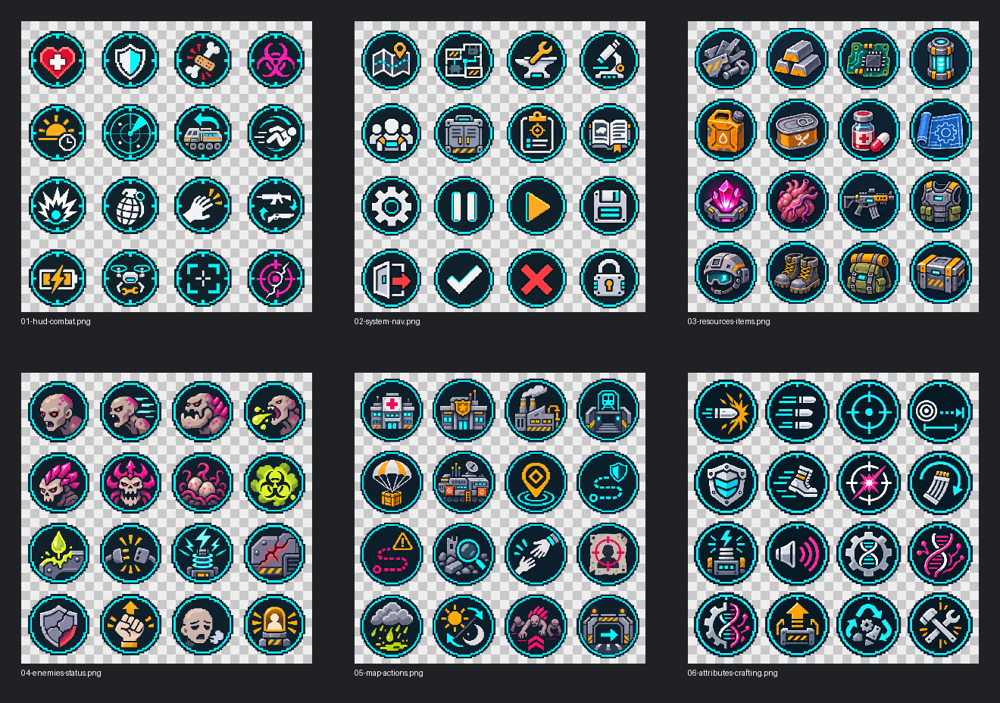
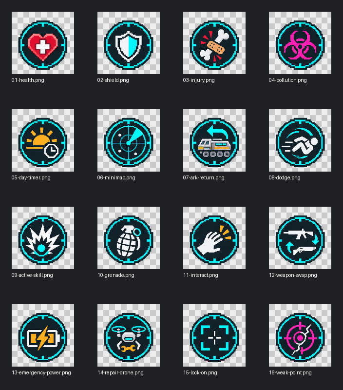
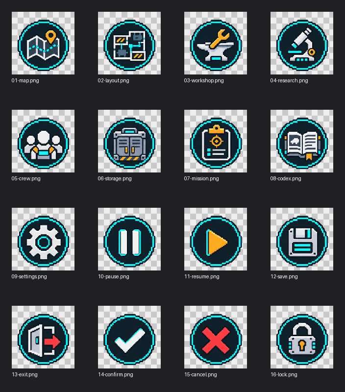
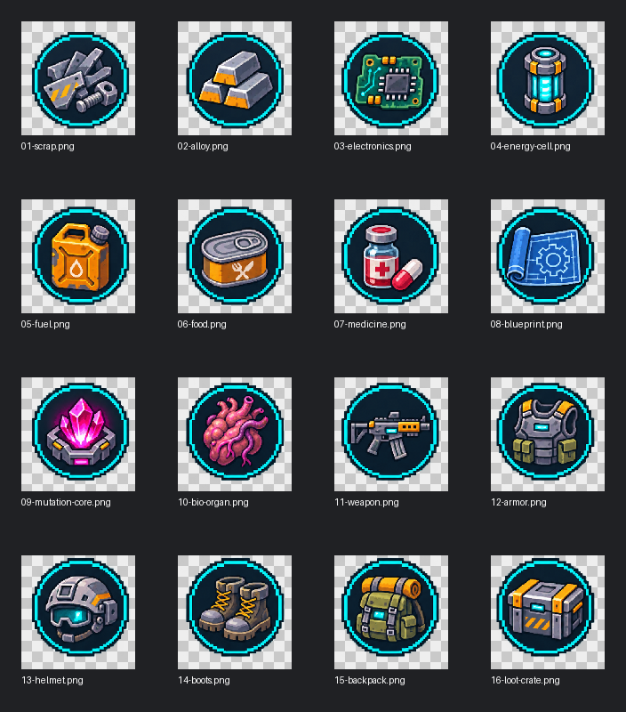
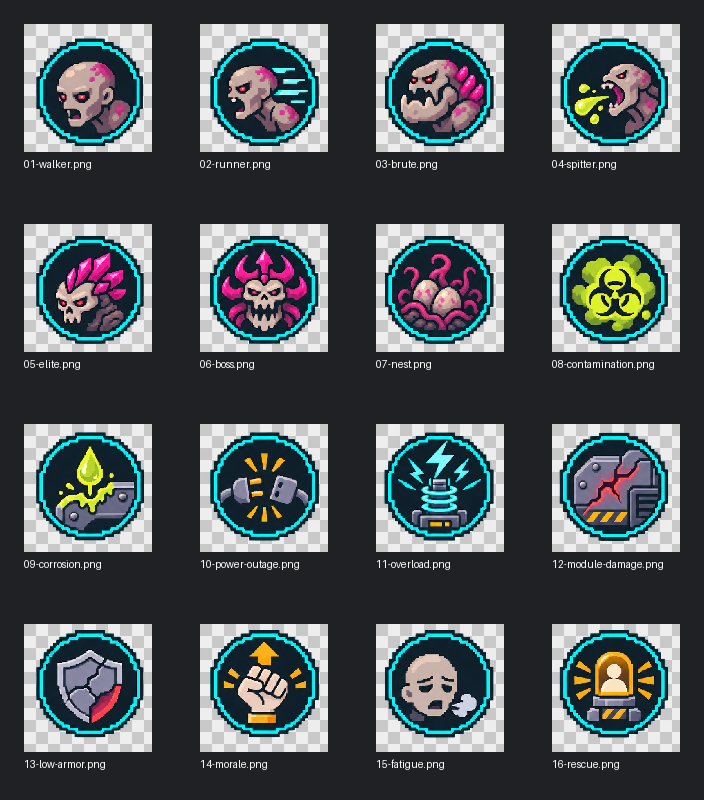
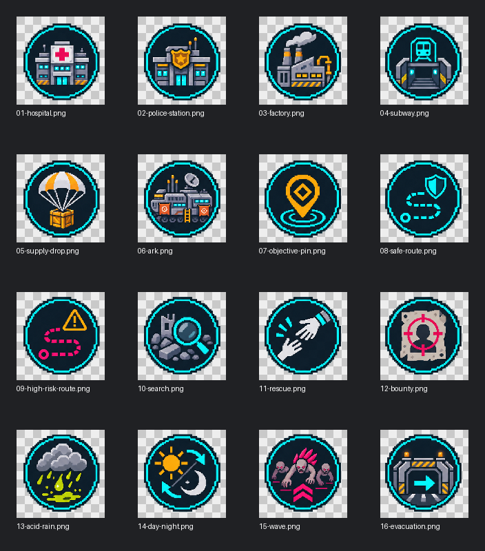
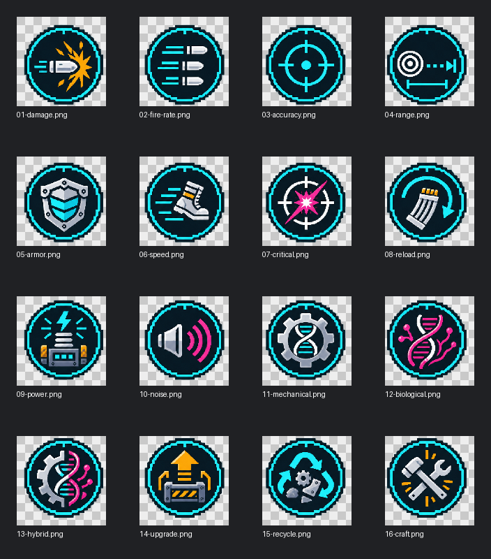

# 《无限进化：末日方舟》UI 图标素材库

> 版本：1.0  
> 日期：2026-11-03  
> 状态：首轮 96 枚素材已生成、切片并完成基础校验  
> 风格基准：[主玩法 UI 效果图](assets/ui-main-gameplay-topdown-v1.png)

## 目标与规格

- 共 6 组、96 枚图标，每组以 4×4 透明母版生成并按行优先顺序切片。
- 单图标标准画布为 128×128 px、RGBA、透明背景；核心图形保持安全边距。
- 采用精美 2D 像素风：深海军蓝外轮廓、冷白主体、青色科技高光，并按语义加入红、琥珀、洋红警示色。
- 不把文字、数字、角标、按键提示或状态数值烘焙进图标；这些内容由程序原生渲染。
- 母版保留在 `assets/ui-icons/source-sheets/`，切片保存在 `assets/ui-icons/icons/<group>/`。
- 当前输出是可用于 UI 验证的首轮素材；接入正式运行时前仍需在 Cocos Creator 原生尺寸下检查采样、边缘和辨识度。

## 01 HUD 与战斗（hud-combat）

| 序号 | 稳定 ID | 中文名称 |
|---:|---|---|
| 01 | `health` | 生命 |
| 02 | `shield` | 护盾 |
| 03 | `injury` | 伤势 |
| 04 | `pollution` | 污染 |
| 05 | `day-timer` | 昼夜计时 |
| 06 | `minimap` | 小地图 |
| 07 | `ark-return` | 返回方舟 |
| 08 | `dodge` | 翻滚闪避 |
| 09 | `active-skill` | 主动技能 |
| 10 | `grenade` | 手雷 |
| 11 | `interact` | 互动 |
| 12 | `weapon-swap` | 切换武器 |
| 13 | `emergency-power` | 应急供电 |
| 14 | `repair-drone` | 维修无人机 |
| 15 | `lock-on` | 锁定目标 |
| 16 | `weak-point` | 弱点 |

## 02 系统导航（system-nav）

| 序号 | 稳定 ID | 中文名称 |
|---:|---|---|
| 01 | `map` | 地图 |
| 02 | `layout` | 方舟布局 |
| 03 | `workshop` | 工坊 |
| 04 | `research` | 科研 |
| 05 | `crew` | 幸存者 |
| 06 | `storage` | 仓库 |
| 07 | `mission` | 任务 |
| 08 | `codex` | 图鉴 |
| 09 | `settings` | 设置 |
| 10 | `pause` | 暂停 |
| 11 | `resume` | 继续 |
| 12 | `save` | 保存 |
| 13 | `exit` | 退出 |
| 14 | `confirm` | 确认 |
| 15 | `cancel` | 取消 |
| 16 | `lock` | 锁定 |

## 03 资源与物品（resources-items）

| 序号 | 稳定 ID | 中文名称 |
|---:|---|---|
| 01 | `scrap` | 废料 |
| 02 | `alloy` | 合金 |
| 03 | `electronics` | 电子元件 |
| 04 | `energy-cell` | 能量电池 |
| 05 | `fuel` | 燃料 |
| 06 | `food` | 食物 |
| 07 | `medicine` | 药品 |
| 08 | `blueprint` | 蓝图 |
| 09 | `mutation-core` | 变异核心 |
| 10 | `bio-organ` | 生物器官 |
| 11 | `weapon` | 武器 |
| 12 | `armor` | 护甲 |
| 13 | `helmet` | 头盔 |
| 14 | `boots` | 靴子 |
| 15 | `backpack` | 背包 |
| 16 | `loot-crate` | 战利品箱 |

## 04 敌人与状态（enemies-status）

| 序号 | 稳定 ID | 中文名称 |
|---:|---|---|
| 01 | `walker` | 行尸 |
| 02 | `runner` | 奔袭者 |
| 03 | `brute` | 巨力怪 |
| 04 | `spitter` | 喷吐者 |
| 05 | `elite` | 精英怪 |
| 06 | `boss` | 首领 |
| 07 | `nest` | 巢穴 |
| 08 | `contamination` | 污染 |
| 09 | `corrosion` | 腐蚀 |
| 10 | `power-outage` | 断电 |
| 11 | `overload` | 过载 |
| 12 | `module-damage` | 模块损坏 |
| 13 | `low-armor` | 低护甲 |
| 14 | `morale` | 士气 |
| 15 | `fatigue` | 疲劳 |
| 16 | `rescue` | 待救援 |

## 05 地图与行动（map-actions）

| 序号 | 稳定 ID | 中文名称 |
|---:|---|---|
| 01 | `hospital` | 医院 |
| 02 | `police-station` | 警局 |
| 03 | `factory` | 工厂 |
| 04 | `subway` | 地铁 |
| 05 | `supply-drop` | 空投补给 |
| 06 | `ark` | 方舟 |
| 07 | `objective-pin` | 目标点 |
| 08 | `safe-route` | 安全路线 |
| 09 | `high-risk-route` | 高危路线 |
| 10 | `search` | 搜索 |
| 11 | `rescue` | 救援行动 |
| 12 | `bounty` | 悬赏 |
| 13 | `acid-rain` | 酸雨 |
| 14 | `day-night` | 昼夜变化 |
| 15 | `wave` | 尸潮 |
| 16 | `evacuation` | 撤离 |

## 06 属性与制造（attributes-crafting）

| 序号 | 稳定 ID | 中文名称 |
|---:|---|---|
| 01 | `damage` | 伤害 |
| 02 | `fire-rate` | 射速 |
| 03 | `accuracy` | 精准 |
| 04 | `range` | 射程 |
| 05 | `armor` | 护甲 |
| 06 | `speed` | 移速 |
| 07 | `critical` | 暴击 |
| 08 | `reload` | 换弹 |
| 09 | `power` | 电力 |
| 10 | `noise` | 噪音 |
| 11 | `mechanical` | 机械路线 |
| 12 | `biological` | 生物路线 |
| 13 | `hybrid` | 混合路线 |
| 14 | `upgrade` | 升级 |
| 15 | `recycle` | 回收 |
| 16 | `craft` | 制造 |

## 生成来源与追踪

- 来源类型：AI 生成并进行确定性切片与尺寸规范化。
- 生成工具：Codex 内置图像生成工具。
- 风格参考：项目自有 UI 效果图 `assets/ui-main-gameplay-topdown-v1.png`。
- 生成日期：2026-11-03。
- 授权与发布状态：项目内部设计验证素材；商业发布前由项目负责人完成最终权利与平台披露复核。

## 校验结果与接入约束

- 文件数：6 张 1254×1254 RGBA 透明母版、96 张 128×128 RGBA 透明切片、6 张带文件名的检查预览图。
- 自动检查：96/96 尺寸正确，96/96 含 Alpha 通道及真实透明像素。
- 视觉检查：行优先顺序与本清单一致；未发现漏图、重复图或相邻单元串图。
- 切片脚本：[slice-ui-icons.ps1](../../scripts/slice-ui-icons.ps1)；重复执行可从母版稳定重建全部切片。
- 机器清单：[icon-manifest.json](assets/ui-icons/icon-manifest.json)。
- Cocos Creator 接入时使用 SpriteFrame、关闭线性过滤，并在 64 px、96 px 与 128 px 三种显示尺寸复查边缘清晰度。
- 当前图标自带统一深色圆底和青色描边，适合直接用于触控按钮、地图标记与状态槽；如后续 UI 需要“裸图形”版本，应另建派生集，不覆盖本套稳定 ID。

