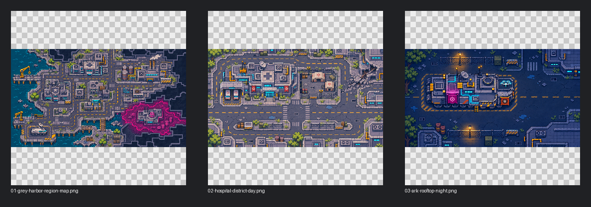
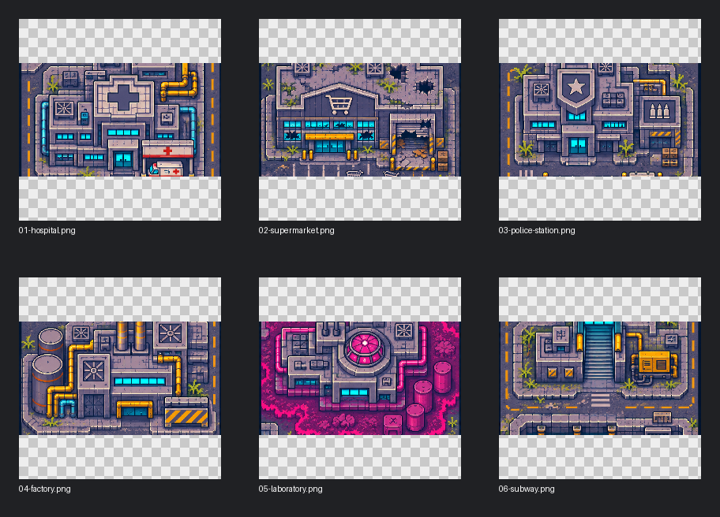
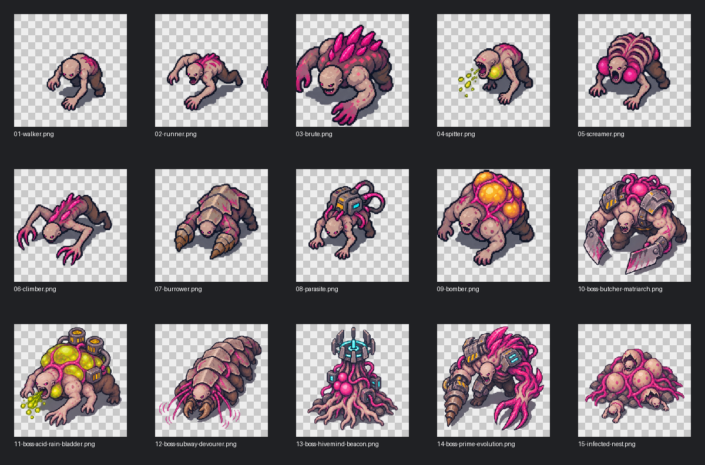
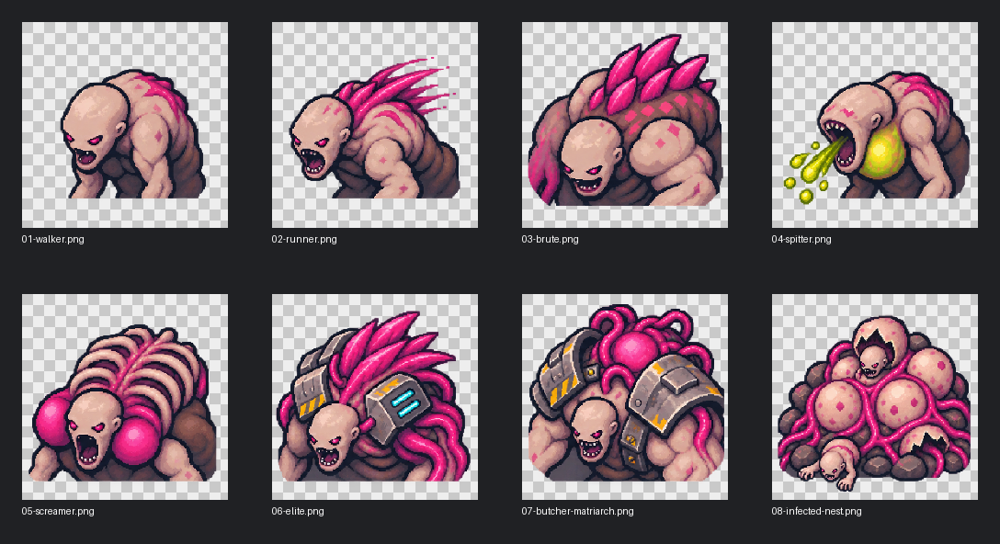
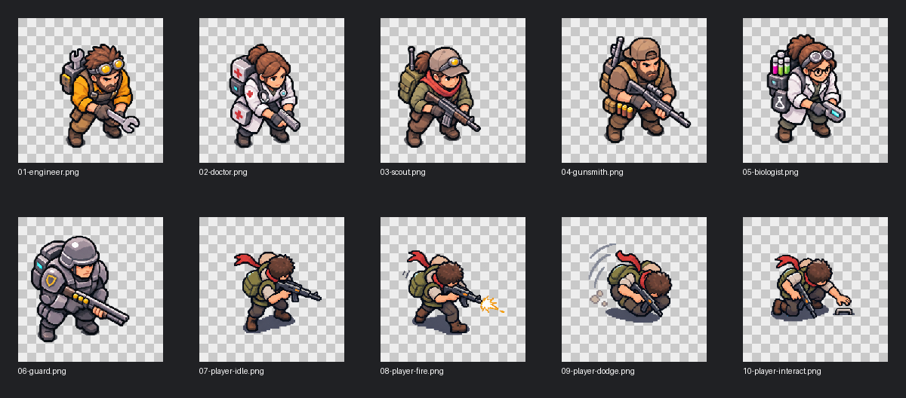
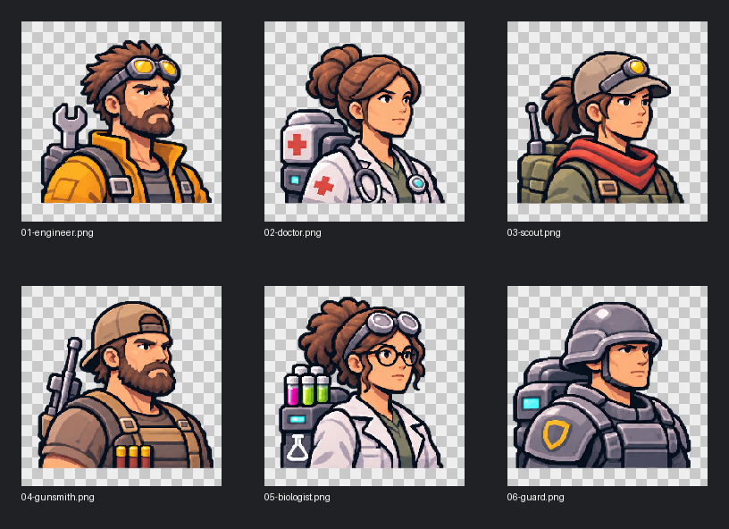

# 《无限进化：末日方舟》地图、人物与怪物素材库

> 版本：1.0  
> 日期：2026-11-03  
> 状态：首轮地图、人物与怪物视觉素材已生成并规范化  
> 视觉基准：[主玩法 UI 效果图](assets/ui-main-gameplay-topdown-v1.png)

## 1. 统一规则

- 所有地图、人物与怪物沿用正交高位俯视 2D 精细像素风；人物与怪物可见头顶、肩背与地面站位。
- 地图不烘焙 HUD、地点图标、路线、文字、人物或怪物，便于程序按状态组合。
- 人物与怪物本体切片为 256×256 RGBA，透明背景；头像为 256×256 RGBA，透明背景且不带 UI 框。
- 地图统一为 1334×750；地点缩略图同时提供 512×512 方形版和 512×288 横向版。
- 夜间方舟防守底图只把屋顶与内部作为玩家战斗空间；维修表现保留无人机停机坪，不展示人物手动维修。

## 2. 地图与战场底图



| 稳定 ID | 文件 | 用途 |
|---|---|---|
| `grey-harbor-region-map` | `maps/01-grey-harbor-region-map.png` | 区域地图与路线覆盖层底图 |
| `hospital-district-day` | `maps/02-hospital-district-day.png` | 白天医院街区探索战场 |
| `ark-rooftop-night` | `maps/03-ark-rooftop-night.png` | 夜间方舟屋顶防守战场 |

## 3. 地点缩略图



地点按医院、超市、警局、工厂、实验区、地铁顺序输出。方形版位于 `location-thumbnails/square/`，横向版位于 `location-thumbnails/wide/`；两套使用相同文件名和稳定 ID。

## 4. 怪物俯视本体



### 常规与特殊怪物

| ID | 中文名称 | 职能轮廓 |
|---|---|---|
| `walker` | 行尸 | 低伏、缓慢推进 |
| `runner` | 奔袭者 | 前倾、长肢高速绕行 |
| `brute` | 巨躯者 | 巨肩与夸张双臂 |
| `spitter` | 喷吐者 | 酸液喉囊与张口姿态 |
| `screamer` | 尖啸者 | 共鸣肋骨与双侧喉囊 |
| `climber` | 攀爬者 | 低趴姿态与钩爪长指 |
| `burrower` | 掘地者 | 分节甲壳与钻掘前肢 |
| `parasite` | 寄生体 | 机械背包与缆线触须 |
| `bomber` | 自爆体 | 高亮爆裂囊 |

### BOSS 与尸巢

| ID | 中文名称 | 章节机制 |
|---|---|---|
| `boss-butcher-matriarch` | 屠夫母体 | 装甲冲撞与背部核心 |
| `boss-acid-rain-bladder` | 酸雨巨囊 | 腐蚀囊与酸液覆盖 |
| `boss-subway-devourer` | 地铁吞噬者 | 分节甲壳与地下突袭 |
| `boss-hivemind-beacon` | 群脑信标 | 根系、寄生与信号冠 |
| `boss-prime-evolution` | 原初进化体 | 机械/生物混合适应 |
| `infected-nest` | 感染尸巢 | 卵囊、触须与幼体 |

## 5. 怪物图鉴头像



头像组包含：行尸、奔袭者、巨躯者、喷吐者、尖啸者、精英感染者、屠夫母体与感染尸巢。UI 负责叠加青色边框、危险等级、名称、血条与弱点信息。

## 6. 人物俯视本体与姿态



职业人物包含工程师、医生、侦察员、枪械师、生物学家和守卫。主角额外提供持枪待机、射击、翻滚和互动四个姿态参考。姿态图用于确定动作轮廓与尺寸，不直接宣称为连续动画帧。

## 7. 人物 UI 头像



头像与俯视本体按相同职业顺序输出，并保持发型、服装、装备和职业色一致。头像不包含姓名、职业文字、状态条或卡槽边框。

## 8. 文件结构

```text
assets/world-characters-monsters/
├─ source/                     AI 生成母版
├─ maps/                       1334×750 地图与战场
├─ location-thumbnails/
│  ├─ square/                  512×512 方形地点图
│  └─ wide/                    512×288 横向地点图
├─ monsters/
│  ├─ topdown/                 256×256 怪物与 BOSS 本体
│  └─ portraits/               256×256 图鉴头像
├─ characters/
│  ├─ topdown/                 256×256 职业人物与主角姿态
│  └─ portraits/               256×256 人物头像
└─ previews/                   带文件名的检查预览
```

## 9. 生成、处理与接入

- 生成方式：Codex 内置图像生成工具，共 10 张母版。
- 最终提示词组：灰港区域地图、医院白天战场、方舟屋顶夜战、六地点缩略图、九种怪物本体、六种 BOSS/尸巢、八种怪物头像、六职业人物本体、六职业人物头像、主角四姿态。
- 规范化脚本：[normalize-world-character-monster-assets.ps1](../../scripts/normalize-world-character-monster-assets.ps1)。
- 机器清单：[asset-manifest.json](assets/world-characters-monsters/asset-manifest.json)。
- 生成资产属于项目内部视觉与原型素材；商业发布前仍需完成平台生成式内容披露、权利复核与 Cocos Creator 原生尺寸验证。
- Cocos Creator 接入时使用 SpriteFrame、最近邻采样、关闭不必要的 mipmap，并在真实战场和 64/96/128 px 三种显示尺寸复查轮廓。

