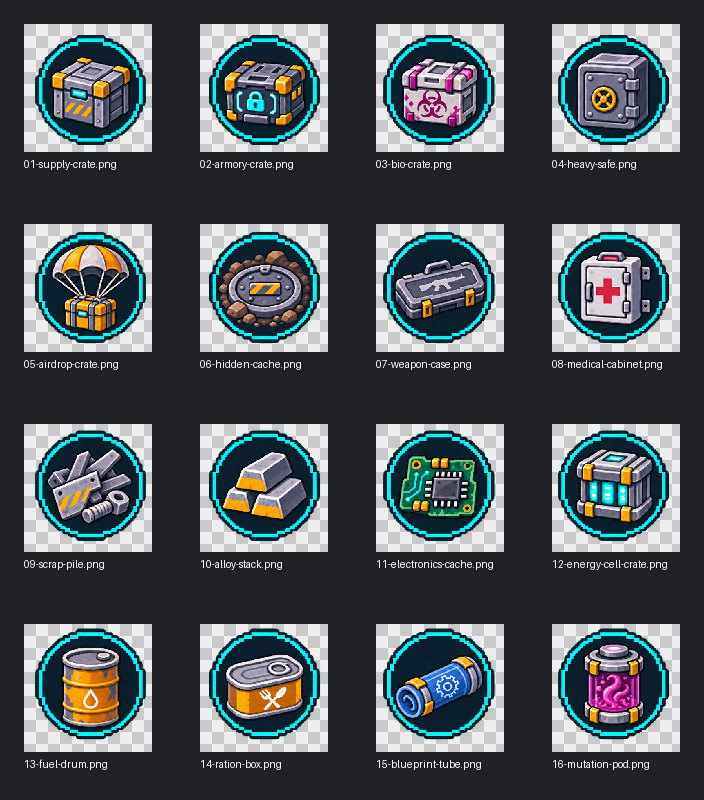
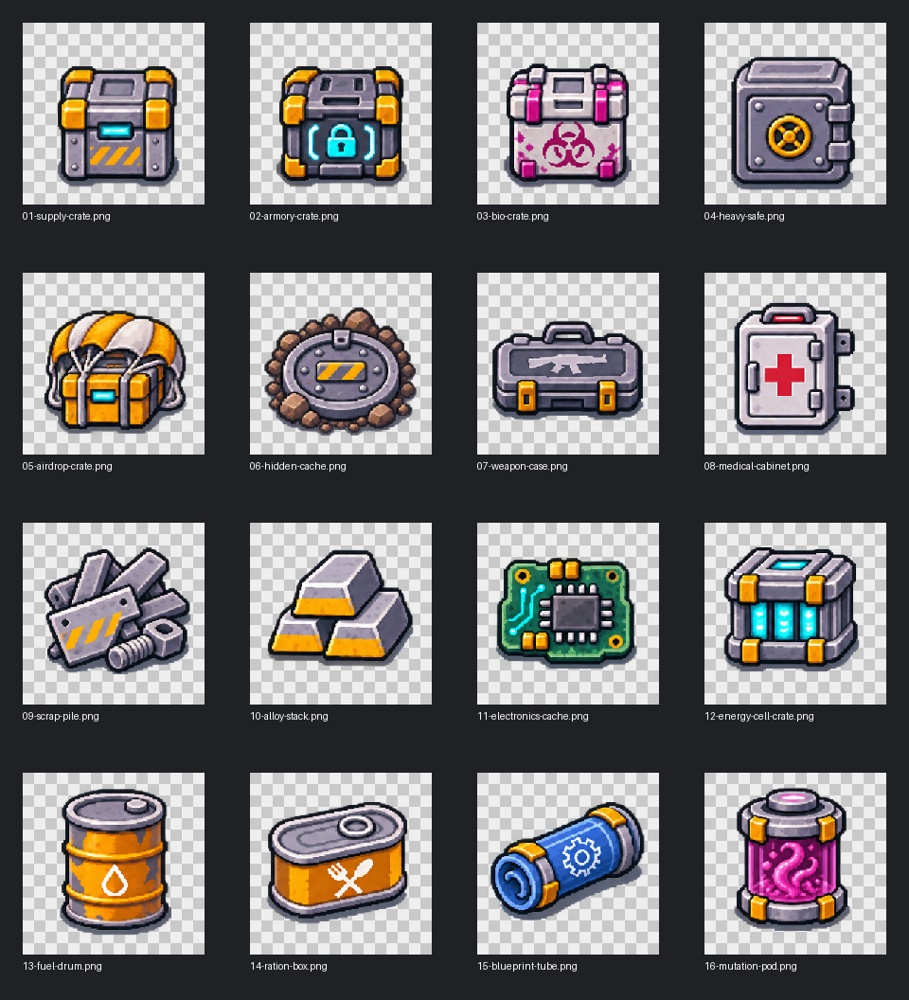
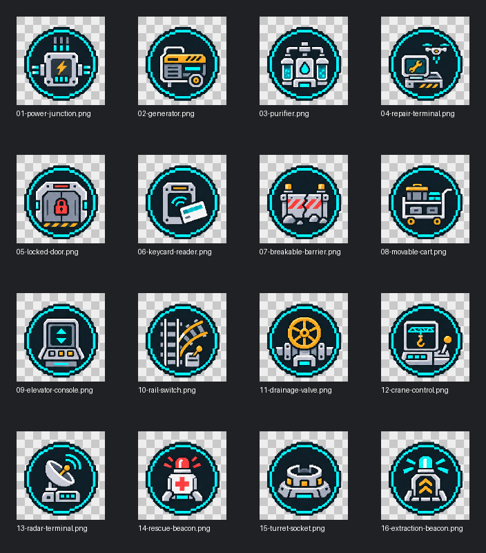
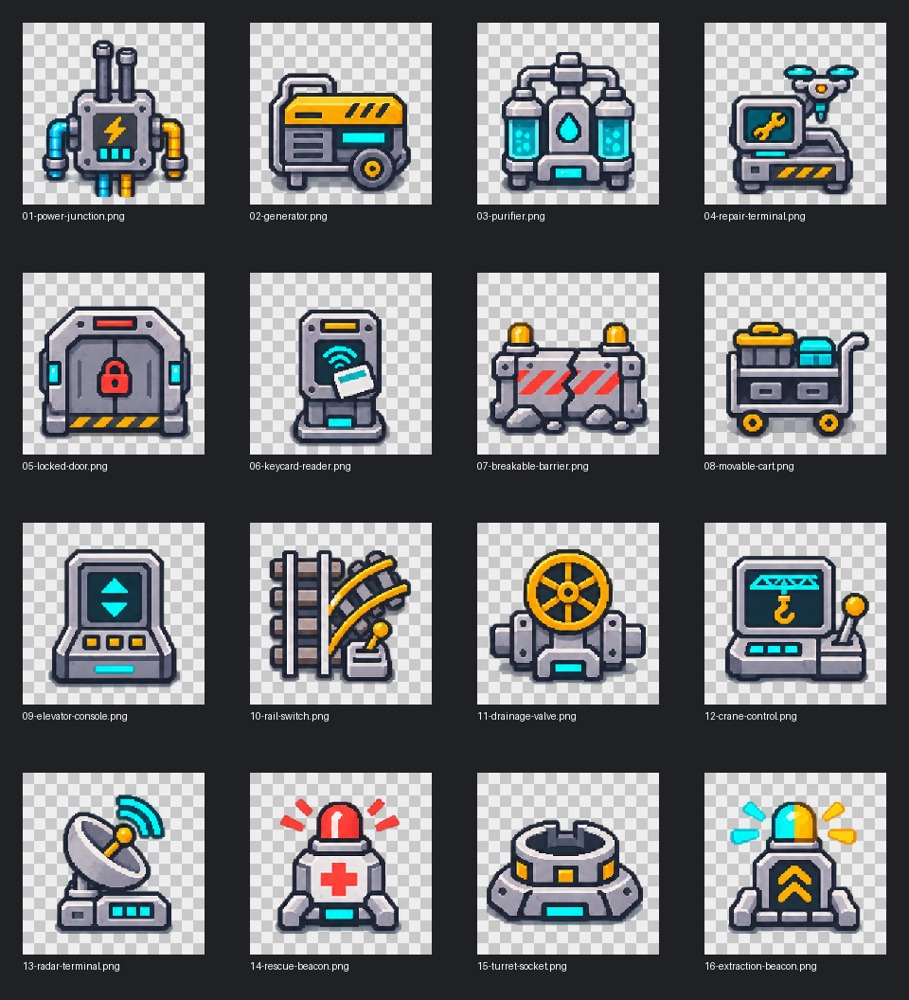

# 《无限进化：末日方舟》地图宝箱与交互物素材库

> 版本：1.0  
> 日期：2026-11-03  
> 状态：首轮 64 张 UI 标记与世界物件已生成并切片  
> 视觉基准：[主玩法 UI 效果图](assets/ui-main-gameplay-topdown-v1.png)

## 1. 资产结构

本素材库包含 32 个稳定玩法对象。每个对象同时提供：

- 128×128 RGBA 地图/UI 标记：用于区域地图、小地图、任务列表与交互提示。
- 256×256 RGBA 俯视世界物件：用于白天探索战场、室内地点与方舟周边场景。

UI 标记与世界物件共享稳定 ID。数量、品质、任务角标、锁定、选中、不可用、已完成、交互距离与危险提示由程序叠加，不重复制作整张图片。

## 2. 宝箱、资源与奖励

### UI 标记



### 世界物件



| 序号 | 稳定 ID | 中文名称 | 主要用途 |
|---:|---|---|---|
| 01 | `supply-crate` | 普通物资箱 | 通用材料快速搜刮 |
| 02 | `armory-crate` | 加密军械箱 | 武器与战术装备 |
| 03 | `bio-crate` | 污染生物箱 | 变异组织与异变装备 |
| 04 | `heavy-safe` | 重型保险柜 | 高品质装备与蓝图 |
| 05 | `airdrop-crate` | 空投箱 | 限时争夺奖励 |
| 06 | `hidden-cache` | 隐藏缓存点 | 情报或雷达揭示 |
| 07 | `weapon-case` | 武器箱 | 定向武器掉落 |
| 08 | `medical-cabinet` | 医疗柜 | 药品与抗污染物资 |
| 09 | `scrap-pile` | 废料堆 | 基础机械材料 |
| 10 | `alloy-stack` | 合金堆 | 高级机械材料 |
| 11 | `electronics-cache` | 电子元件箱 | 科技与模块材料 |
| 12 | `energy-cell-crate` | 能量电池箱 | 供电与科技资源 |
| 13 | `fuel-drum` | 燃料桶 | 方舟燃料与高危爆炸物 |
| 14 | `ration-box` | 食物补给箱 | 士气与生存物资 |
| 15 | `blueprint-tube` | 蓝图筒 | 永久制造配方 |
| 16 | `mutation-pod` | 变异样本舱 | 生物研究材料 |

## 3. 设施、机关与事件

### UI 标记



### 世界物件



| 序号 | 稳定 ID | 中文名称 | 主要用途 |
|---:|---|---|---|
| 01 | `power-junction` | 供电接线箱 | 恢复区域供电 |
| 02 | `generator` | 发电机 | 临时能源与噪音事件 |
| 03 | `purifier` | 净化设备 | 清理污染或建立安全区 |
| 04 | `repair-terminal` | 自动维修终端 | 远程系统/无人机维修 |
| 05 | `locked-door` | 锁区安全门 | 密钥、供电或任务限制 |
| 06 | `keycard-reader` | 密钥读卡器 | 消耗钥匙或权限解锁 |
| 07 | `breakable-barrier` | 可破坏路障 | 武器或工具开路 |
| 08 | `movable-cart` | 可推动载具 | 搬运、堵门与环境解谜 |
| 09 | `elevator-console` | 电梯控制台 | 楼层与室内路线切换 |
| 10 | `rail-switch` | 轨道切换器 | 地铁路线与列车机关 |
| 11 | `drainage-valve` | 排水阀门 | 积水与导电区域处理 |
| 12 | `crane-control` | 吊机控制台 | 工厂搬运与路径改变 |
| 13 | `radar-terminal` | 雷达终端 | 揭示路线、宝箱和尸潮趋势 |
| 14 | `rescue-beacon` | 求救信标 | 幸存者救援事件 |
| 15 | `turret-socket` | 自动炮塔基座 | 临时防御设施安装点 |
| 16 | `extraction-beacon` | 紧急撤离信标 | 保底撤离与限时事件 |

## 4. 文件结构

```text
assets/map-interactables/
├─ source-sheets/              4 张 4×4 AI 生成母版
├─ ui-markers/
│  ├─ loot-resource/           16 张 128×128 地图标记
│  └─ facility-event/          16 张 128×128 地图标记
├─ world-props/
│  ├─ loot-resource/           16 张 256×256 世界物件
│  └─ facility-event/          16 张 256×256 世界物件
├─ previews/                   4 张检查预览
└─ asset-manifest.json         机器可读清单
```

## 5. 开发使用规则

- 配置表只保存稳定 ID，不把中文名称作为唯一引用。
- 地图界面使用 `ui-markers/`，战场实体使用 `world-props/`；两者通过同一 ID 配对。
- 世界物件的碰撞体、交互点、掉落表和开启动画由 prefab/配置定义，不能从图片轮廓自动推断。
- 普通、任务、稀有、高危、已完成和不可用状态优先使用程序描边、颜色、角标与粒子；只有物件结构真正改变时才新增图片。
- `repair-terminal` 只表示自动维修系统与维修无人机，不展示角色手动维修。
- 图标和物件均使用最近邻采样；Cocos Creator 接入后应在 64/96/128 px 和真实地图背景下复查可读性。

## 6. 生成与来源

- 生成方式：Codex 内置图像生成工具。
- 最终提示词组：宝箱/资源 UI 标记、设施/事件 UI 标记、宝箱/资源世界物件、设施/事件世界物件。
- 规范化脚本：[slice-map-interactables.ps1](../../scripts/slice-map-interactables.ps1)。
- 机器清单：[asset-manifest.json](assets/map-interactables/asset-manifest.json)。
- 状态：项目内部视觉与原型素材；商业发布前需完成平台生成式内容披露、权利复核和 Cocos Creator 原生尺寸验证。

