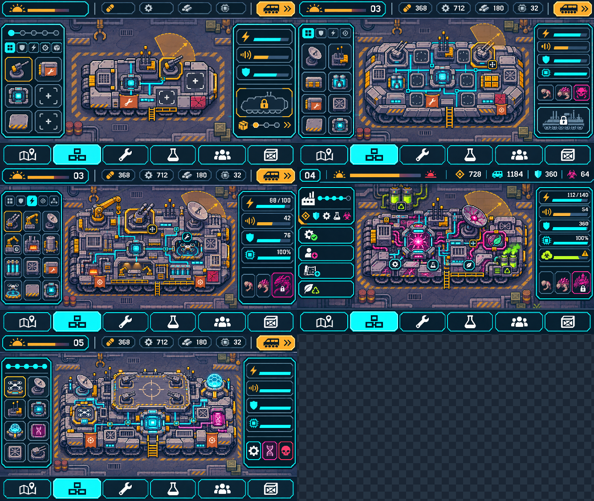
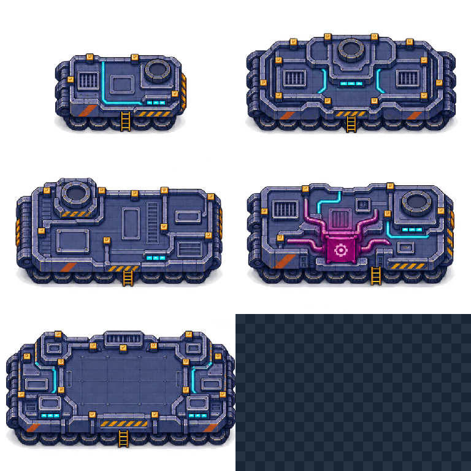
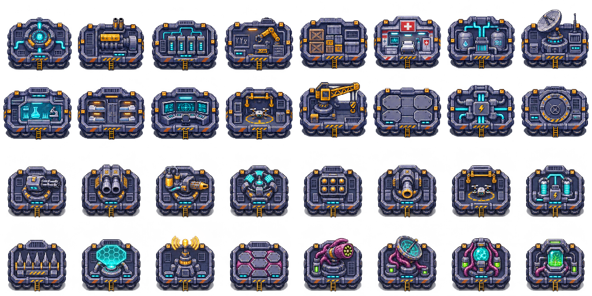
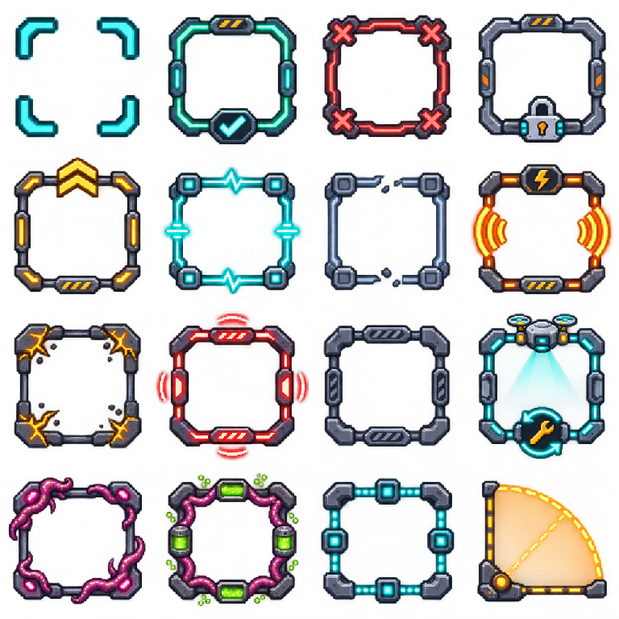

# 16｜庇护所等级 UI 与动态素材库

> 版本：1.0  
> 日期：2026-11-03  
> 状态：五级效果图与可拼装素材已生成，用于界面确认、配置引用和客户端动态组合

## 1. 资产定位

本素材库补齐移动方舟五个成长阶段的界面效果和可拆分美术。资产分为四层：等级 UI 效果图、方舟底盘、可替换模块、交互/状态覆盖层。客户端应按稳定 ID 组合这些层，不应把整辆方舟、所有模块和状态合并成一张运行时图片。

统一视觉规则沿用 [UI、画面、音频、引导与移动端体验](08-presentation-mobile-ux.md) 和 [UI 效果图](12-ui-mockups.md)：横屏正交高位俯视 2D 精细像素、深蓝黑 UI、科技青描边、白色功能图标、琥珀交互、红色危险、洋红生化。

## 2. 五级 UI 效果图

| 等级 | 稳定 ID | 中文阶段 | 主要可视变化 | 效果图 |
|---:|---|---|---|---|
| 1 | `modified-transport` | 改装运输车 | 单层短车体、少量外挂、基础核心与轻武器 | `ui-mockups/01-modified-transport.png` |
| 2 | `armored-tracked-fortress` | 装甲履带堡垒 | 双层装甲、连续履带、完整供电与更多插槽 | `ui-mockups/02-armored-tracked-fortress.png` |
| 3 | `mobile-industrial-platform` | 移动工业平台 | 宽体甲板、吊臂、重火力、自动维修无人机坞 | `ui-mockups/03-mobile-industrial-platform.png` |
| 4 | `biomechanical-ark` | 生化机械方舟 | 机械与受控活体组织融合、污染管理与混合插槽 | `ui-mockups/04-biomechanical-ark.png` |
| 5 | `doomsday-mobile-citadel` | 末日移动城塞 | 多区段城塞、大型屋顶战斗区、终局核心与路线选择 | `ui-mockups/05-doomsday-mobile-citadel.png` |

效果图用于确认构图、信息层级和等级辨识，不直接作为最终界面切图。正式文字、动态数字、进度条、触控热区和安全区布局必须在 Cocos Creator 中重建。

## 3. 方舟底盘

底盘位于 `assets/shelter-levels/ark-bases/`，共 5 张 768×512 RGBA。底图包含不可替换的车体、履带、固定甲板、核心基座、插槽底座和梯口；武器、功能设施、人物、敌人、射界和状态提示均不属于底盘。

统一使用底部中心锚点。升级阶段改变外轮廓和承载面积，但旧模块稳定 ID 不变，可重新安装到新底盘的合法槽位。

## 4. 结构与功能模块

模块位于 `assets/shelter-levels/modules/structural-utility/`，每张 256×256 RGBA：

| 序号 | 稳定 ID | 功能 |
|---:|---|---|
| 01 | `core-reactor` | 方舟固定能源核心 |
| 02 | `generator` | 常规发电与过载 |
| 03 | `battery-bank` | 储能与应急供电 |
| 04 | `workshop` | 制造、改装和拆解 |
| 05 | `storage` | 资源与模块仓储 |
| 06 | `infirmary` | 医疗与复苏支持 |
| 07 | `purifier` | 污染、空气与水处理 |
| 08 | `radar` | 探测、标记和预警 |
| 09 | `research-lab` | 科技和生化研究 |
| 10 | `crew-quarters` | 幸存者居住模块 |
| 11 | `command-console` | 方舟控制与应急调度 |
| 12 | `drone-repair-dock` | 自动维修无人机停放与充能 |
| 13 | `crane` | 工业搬运与重型安装 |
| 14 | `armor-panel` | 可替换装甲单元 |
| 15 | `power-junction` | 供电线路节点 |
| 16 | `hatch-ladder` | 屋顶与内部通道 |

## 5. 防御与进化模块

模块位于 `assets/shelter-levels/modules/defense-evolution/`，每张 256×256 RGBA：

| 序号 | 稳定 ID | 功能 |
|---:|---|---|
| 01 | `machine-gun-turret` | 连续火力 |
| 02 | `shotgun-turret` | 近距离扇形火力 |
| 03 | `flame-turret` | 持续燃烧与区域阻断 |
| 04 | `emp-turret` | 电磁控制和护盾干扰 |
| 05 | `missile-rack` | 远程爆炸火力 |
| 06 | `heavy-cannon` | 高冲击重炮 |
| 07 | `drone-platform` | 战斗无人机起降 |
| 08 | `electric-fence-node` | 电网供能与连锁控制 |
| 09 | `spike-barricade` | 近线阻挡和反伤 |
| 10 | `shield-emitter` | 局部护盾投射 |
| 11 | `lure-beacon` | 噪音诱敌和目标引导 |
| 12 | `regenerative-armor` | 生化再生装甲 |
| 13 | `hunter-gland` | 追猎腺体武器进化 |
| 14 | `sensory-organ` | 感知器官雷达进化 |
| 15 | `electric-sac` | 电囊能源进化 |
| 16 | `symbiosis-pod` | 共生治疗舱 |

## 6. 交互与状态覆盖层

覆盖层位于 `assets/shelter-levels/overlays/`，每张 256×256 RGBA：

| 序号 | 稳定 ID | 使用场景 |
|---:|---|---|
| 01 | `selected` | 当前选中 |
| 02 | `placement-valid` | 合法放置 |
| 03 | `placement-invalid` | 非法放置 |
| 04 | `locked` | 未解锁或槽位锁定 |
| 05 | `upgrade-ready` | 满足升级条件 |
| 06 | `powered` | 正常供电 |
| 07 | `unpowered` | 断电但未损坏 |
| 08 | `overloaded` | 过载与热量风险 |
| 09 | `damaged` | 30%–70% 耐久 |
| 10 | `critical` | 1%–30% 耐久 |
| 11 | `offline` | 0% 耐久或主动停机 |
| 12 | `auto-repair` | 无人机远程维修中 |
| 13 | `parasite` | 机械寄生 |
| 14 | `bio-unstable` | 生化模块失控风险 |
| 15 | `adjacency-bonus` | 相邻加成成立 |
| 16 | `range-sector` | 炮塔射界预览 |

同一语义组按最高优先级显示：`critical > damaged`、`overloaded > powered > unpowered > offline`、`placement-invalid > placement-valid > selected`。自动维修、生化失控和寄生可与耐久层组合，但不能遮挡正式数值和交互焦点。

## 7. 运行时拼装

建议渲染顺序：

1. 方舟底盘。
2. 已安装模块。
3. 供电线和生化线路。
4. 耐久状态。
5. 供电状态。
6. 自动维修、寄生或生化失控。
7. 选中、放置和射界。
8. 代码原生文字、数值、血条和触控组件。

插槽位置、合法类型、朝向、层级、碰撞体和供电连接必须由配置表维护，不能通过图片颜色或像素位置反推。夜间维修只显示无人机、维修光束和 `auto-repair` 覆盖层，不生成角色手动维修动画。

## 8. Cocos Creator 导入建议

- 底盘、模块与覆盖层导入为 SpriteFrame，关闭有损压缩，使用最近邻采样；不生成会模糊像素边缘的 mipmap。
- 方舟节点使用底盘容器、插槽容器、线路容器、状态容器和 UI 容器分层；插槽节点通过稳定 ID 绑定配置。
- 效果图仅作为编辑器对照，不进入运行时图集。
- 动画需求另行制作：炮塔开火/过热/停机、无人机起降/维修、核心脉动、生化组织失控和供电线路流动。

## 9. 生成与派生记录

- 生成方式：Codex 内置 imagegen。
- 生成日期：2026-11-03。
- 母版：5 张 UI、1 张 2×3 底盘、2 张 4×4 模块、1 张 4×4 覆盖层。
- 派生方式：`scripts/normalize-shelter-level-assets.ps1` 确定性中心裁切、网格切片、最近邻缩放和预览生成。
- 机器清单：`assets/shelter-levels/asset-manifest.json`。
- 商业发布前仍需完成人工美术清理、真像素网格整理、平台生成内容披露和最终版权审核。

