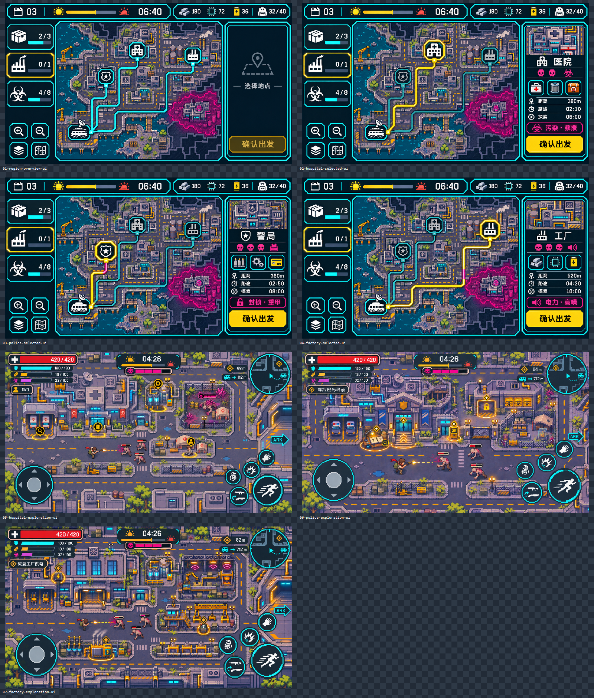
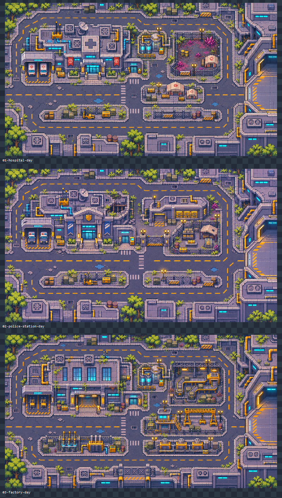
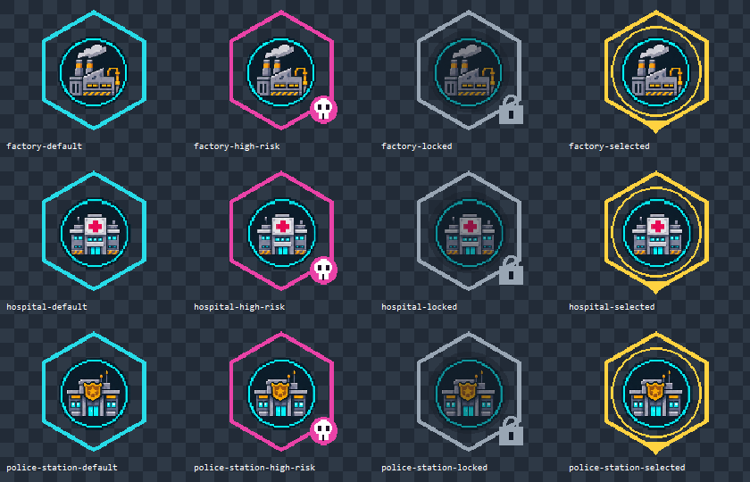
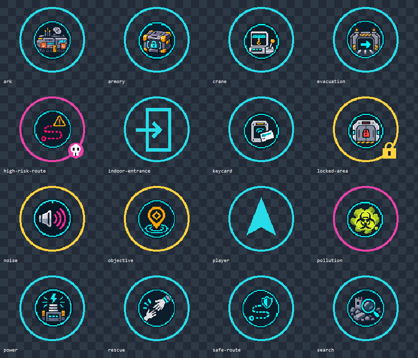
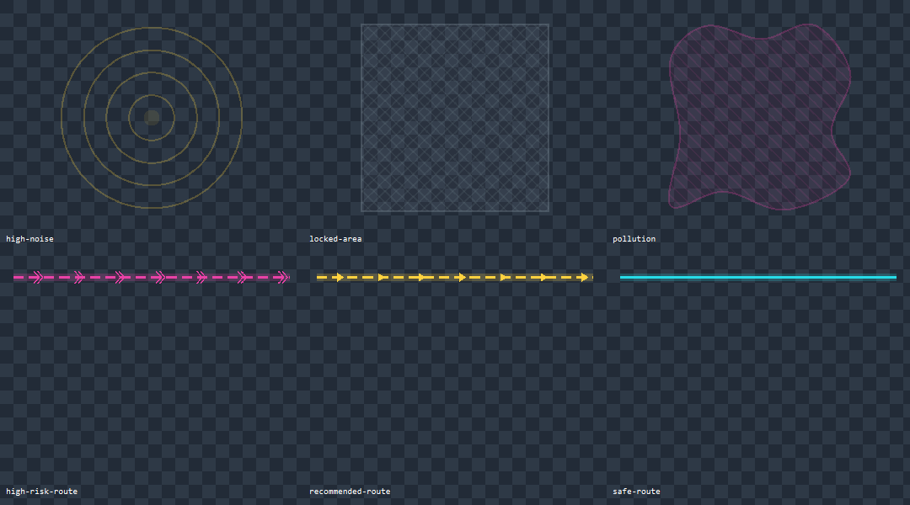
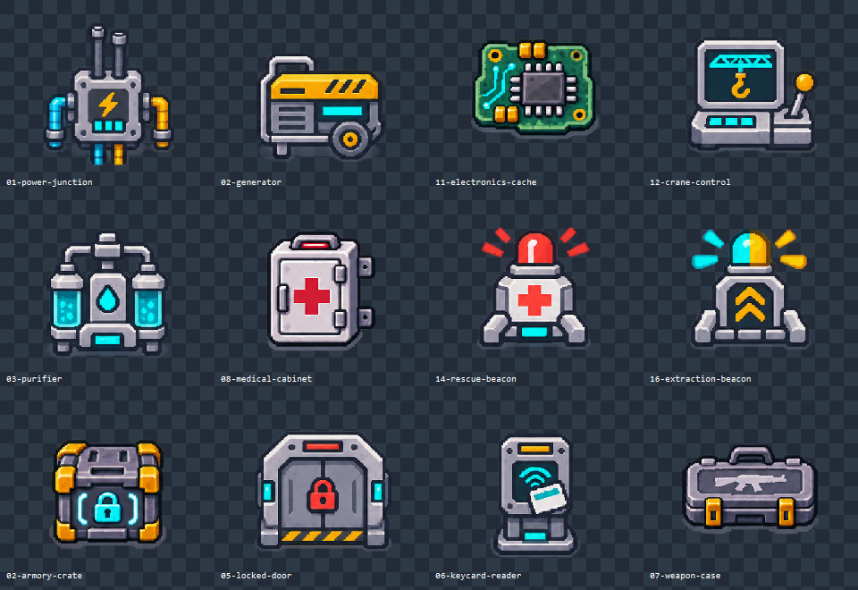

# 17｜地图 UI 与探索辨识度素材库

> 版本：1.0
> 日期：2026-11-03
> 状态：内部视觉验证与文件校验完成；商业发布前仍需复核
> 目标：Cocos Creator 3.8.8 + Oops Framework，横屏 1334×750

本批覆盖医院、警局和工厂，落实[地图 UI 与探索辨识度设计](../superpowers/specs/2026-11-03-map-ui-exploration-clarity-assets-design.md)。区域情报地图负责选点和计划行程，探索战场负责角色移动、战斗与互动，小地图负责战场导航。术语见[世界地图与白天探索](02-world-exploration.md)。本批交付视觉资源，不包含实际关卡加载、寻路、碰撞、角色动画或 Cocos 交互代码。

## 交互流程与界面辨识

1. 打开区域情报地图：三个地点使用青色默认节点，方舟和路线可见；右侧详情栏未激活，“确认出发”为禁用状态。
2. 点击地点：只改变选中目标。节点在原中心放大并加黄色边框，其余节点降低亮度；右侧固定详情栏显示缩略图、危险等级、三类奖励、距离、路途时间、探索时间和事件风险。
3. 点击详情栏内黄色“确认出发”：这是进入探索战场的唯一操作。节点点击与出发确认采用不同反馈；禁止点击节点直接加载或传送。
4. 进入探索战场：显示玩家、敌人、左下摇杆、右下互动/技能/手雷/换枪/翻滚，以及右上小地图。世界互动使用暖黄标记，撤离使用青色方舟指引。医院、警局、工厂共用相同 HUD 区域和控制拓扑。
5. 小地图可打开完整地图查看位置、路线与标记；两者均不提供瞬移。

| 地点 | 详情示意：距离／路途／探索 | 奖励倾向 | 战场身份与互动 |
|---|---|---|---|
| 医院 | 280m／02:10／06:00 | 医疗、过滤、救援物资 | 救护车搜索、医院入口、净化设备、受伤幸存者；污染围栏 |
| 警局 | 360m／02:50／08:00 | 弹药、武器零件、门禁卡 | 警局入口、独立门禁终端、带锁武器库、密码笔记线索 |
| 工厂 | 520m／04:20／10:00 | 金属、电路板、电池 | 配电箱、发电机、吊机控制台、含传送带/机械臂/冲压机的高噪生产区 |

表中时间、距离、奖励和效果图中的战斗数值用于解释布局，正式数值由配置和运行时组件提供。

## 颜色与状态

| 颜色 | 语义 | 额外形状反馈 |
|---|---|---|
| 青色 `#27DCE8` | 已发现可选地点、普通 HUD、安全路线、方舟导航 | 默认六边形节点、圆形标记、实线路线 |
| 黄色 `#FFD240` | 当前选中、推荐路线、出发确认；世界互动暖黄强调 | 选中双环与底部尖角、推荐虚线箭头、地面环 |
| 洋红 `#EA42A7` | 污染、高风险、敌人威胁 | 高风险骷髅角标、双折线路标、污染有机斜纹 |
| 灰色 `#99A6B4` | 未发现、未解锁、不可达或禁用 | 暗化节点与锁角标、锁区矩形交叉线 |

锁定节点的状态色为灰；`locked-area` 互动标记使用黄色锁提示，锁区覆盖层使用灰色交叉线。`noise` 标记与高噪覆盖层为黄色事件提示，完整工厂效果图中的洋红声波表达正在发生的危险。状态同时依靠轮廓、锁、骷髅、箭头与纹理辨认。

## 文件清单与机器接口

素材根目录为 `assets/map-ui-v2/`，机器清单为 [asset-manifest.json](assets/map-ui-v2/asset-manifest.json)。清单所有输出 `path`、复用 `originalPath` 与 `sourcePaths` 均从 **NewProject 仓库根目录**解析；不是从清单文件所在目录解析。稳定 ID 位于每组的 `assets[].id`，供配置引用。

清单逐张记录尺寸、颜色模式、Alpha 要求、SHA256、生成类别和规范化方式。共 **78 张 PNG**：10 张原始生成源图，以及 68 张规范化、组合或复用输出。15 次生成/编辑事件的完整提示词、参考、历史结果与最终映射保存在 `generationHistory`；其中 5 个结果已被后续编辑替代，不作为额外交付 PNG 计数。`generatedResultPath` 和绝对 `referencePaths` 是生产机器上的历史来源记录；完整原图已保存在仓库 `source/`，重建不依赖这些机器目录。

| 清单组 | 目录 | 数量 | 尺寸／透明要求 | 来源 |
|---|---|---:|---|---|
| `sourceMaps` | `source/01`–`03` | 3 | 1672×941，RGB 不透明 | 内置 image_gen 生成原件 |
| `sourceMockups` | `source/04`–`10` | 7 | 04–07：1672×940；08–10：1672×941，RGB | 内置 image_gen 生成/编辑原件 |
| `explorationMaps` | `maps/` | 3 | 1334×750，RGBA 不透明底图 | 源图居中覆盖裁切与最近邻缩放 |
| `uiMockups` | `mockups/` | 7 | 1334×750，RGBA 完整画面 | 源图居中覆盖裁切与最近邻缩放 |
| `locationThumbnails` | `location-thumbnails/{square,wide}/` | 6 | 512×512／512×288 | 逐字节复用现有缩略图 |
| `nodeStates` | `map-nodes/` | 12 | 128×128，RGBA 透明 | 现有地点图标加确定性环框/角标 |
| `interactableMarkers` | `markers/` | 16 | 128×128，RGBA 透明 | 现有语义图标与脚本形状组合 |
| `routeOverlays` | `route-overlays/` | 3 | 1024×128，RGBA 透明 | 确定性线条、虚线、箭头和折线 |
| `hazardOverlays` | `hazard-overlays/` | 3 | 512×512，RGBA 透明 | 确定性纹理/波纹，Alpha 上限 114/255 |
| `gatheredInteractables` | `interactables/{hospital,police-station,factory}/` | 12 | 透明 RGBA；各图实际尺寸见清单 | 逐字节复用现有世界物件，保留文件名 |
| `previews` | `previews/` | 6 | 不透明棋盘格联系表；尺寸见清单 | 由输出素材排序组合，仅供审阅 |

### 完整效果图与探索底图

| 完整效果图 | 文件 |
|---|---|
| 区域总览 | [01-region-overview-ui.png](assets/map-ui-v2/mockups/01-region-overview-ui.png) |
| 医院选中 | [02-hospital-selected-ui.png](assets/map-ui-v2/mockups/02-hospital-selected-ui.png) |
| 警局选中 | [03-police-selected-ui.png](assets/map-ui-v2/mockups/03-police-selected-ui.png) |
| 工厂选中 | [04-factory-selected-ui.png](assets/map-ui-v2/mockups/04-factory-selected-ui.png) |
| 医院探索 | [05-hospital-exploration-ui.png](assets/map-ui-v2/mockups/05-hospital-exploration-ui.png) |
| 警局探索 | [06-police-exploration-ui.png](assets/map-ui-v2/mockups/06-police-exploration-ui.png) |
| 工厂探索 | [07-factory-exploration-ui.png](assets/map-ui-v2/mockups/07-factory-exploration-ui.png) |



三张无 HUD 底图为 [医院](assets/map-ui-v2/maps/01-hospital-day.png)、[警局](assets/map-ui-v2/maps/02-police-station-day.png)、[工厂](assets/map-ui-v2/maps/03-factory-day.png)。底图保留主路、支路、室内入口、互动区域和右侧方舟返程边缘，不烘焙 UI、角色、敌人或导航路线。



### 缩略图、节点与标记

三个地点保留原名 `01-hospital.png`、`03-police-station.png`、`04-factory.png`，各有 `square/` 和 `wide/` 两种。六张缩略图的原路径均在 `world-characters-monsters/location-thumbnails/`，清单记录精确对应关系。

节点名采用 `{hospital,police-station,factory}-{default,selected,high-risk,locked}.png`，共 12 张，中心来自现有 UI 图标库；选中状态增加双环与尖角，高风险附骷髅，锁定附暗化与锁。



16 枚标记依次覆盖 `player`、`ark`、`objective`、`search`、`indoor-entrance`、`evacuation`、`rescue`、`keycard`、`armory`、`power`、`crane`、`noise`、`pollution`、`safe-route`、`high-risk-route`、`locked-area`。玩家箭头和室内入口为脚本形状，其余图标复用路径在清单逐项列出；标记是 UI，不替代世界交互物。



### 路线、风险与世界交互物

路线为 `safe-route.png`（青色实线）、`recommended-route.png`（黄色虚线箭头）、`high-risk-route.png`（洋红虚线双折线）。风险层为 `pollution.png`（有机斜纹）、`locked-area.png`（矩形交叉纹）、`high-noise.png`（同心波纹）。它们完全由脚本确定性绘制，属于生成衍生层，不是新增 AI 生成源图。



| 地点 | 归集的原名世界物件 |
|---|---|
| 医院 | `08-medical-cabinet.png`、`03-purifier.png`、`14-rescue-beacon.png`、`16-extraction-beacon.png` |
| 警局 | `02-armory-crate.png`、`05-locked-door.png`、`06-keycard-reader.png`、`07-weapon-case.png` |
| 工厂 | `01-power-junction.png`、`02-generator.png`、`12-crane-control.png`、`11-electronics-cache.png` |

以上 12 张来自 `map-interactables/world-props/`，清单保留 `loot-resource/` 或 `facility-event/` 原始路径；复制不改变图像与命名。它们与 16 枚 UI 标记是两组独立资源。



## 运行时图层与 Cocos 导入

区域情报界面从下到上为区域底图、风险覆盖层、路线、地点节点与方舟、选中反馈、左侧筛选/目标、右侧详情、顶栏与出发按钮。路线应跟随地图坐标，不随固定详情面板移动。

探索战场从下到上为探索底图、风险/地面反馈、世界交互物、角色与敌人（按脚点排序）、互动标记与目标箭头、HUD、小地图和操作控件。世界标记锚定目标，HUD 使用屏幕坐标。方舟返程点位于本批地图右边缘；警局密码目标在角色西北，小地图目标方向应随真实目标计算。

- PNG 以 `sprite-frame` 导入；保留透明 Alpha，像素素材采用最近邻采样，关闭平滑和会损伤透明边缘的有损压缩。先在目标设备检查透明边缘，再决定图集与压缩策略。
- 场景以 1334×750 为布局基准；图标原件为 128×128，验证 64/96/128 px 三档清晰度。UI 节点/标记使用中心锚点；世界物件使用脚点或实际接地位置锚点，逐件配置，避免悬浮。
- 路线层按真实路径拆段/旋转或以运行时线条复刻；不要拉伸一整条示意路线覆盖任意地图。风险层低 Alpha 叠加，保持道路、敌人和交互点清晰。
- 完整 `mockups/` 只作布局参考；运行时界面使用独立精灵和原生 Label/Button/ProgressBar 等组件。中文、距离、倒计时、奖励数量、锁定条件和禁用行为由代码绘制和控制。
- 生成效果图的 HUD 间距存在细小差异，小地图是示意；实际共用同一 HUD prefab，并根据玩家与方舟坐标生成导航。底图不作为碰撞或导航网格。
- 六张 `previews/` 联系表包含背景与文字，不导入运行时图集。

## 来源、复核与重建

生成使用 Codex 内置 `image_gen.imagegen`。医院底图以现有医院街区和主玩法效果图为参考，警局/工厂沿用医院风格；区域界面参考灰港区域图与世界地图 UI；探索 HUD 参考既有白天探索效果图。原始 10 张源图完整保留，历史编辑结果与提示词映射见清单；复用图标、缩略图与世界物件分别追溯到[UI 图标库](13-ui-icon-library.md)、[世界素材库](14-world-character-monster-assets.md)和[交互物库](15-map-interactable-assets.md)，不修改其源库或原清单。

当前状态为 `internal-visual-validation`。生产阶段已检查原生尺寸的源图和六张联系表；文件校验覆盖尺寸、有效透明层、数量、复制一致性和确定性重建。商业发布仍需复核素材权利、视觉细节与设备内表现；此状态不代表已经完成商用审查或引擎内验证。

在 Windows 仓库根目录运行：

```powershell
pwsh -NoProfile -File scripts/normalize-map-ui-v2-assets.ps1
pwsh -NoProfile -File scripts/test-map-ui-v2-assets.ps1
```

[规范化脚本](../../scripts/normalize-map-ui-v2-assets.ps1)使用 System.Drawing 居中覆盖裁切、最近邻采样与 SourceCopy/SourceOver 组合；[验证脚本](../../scripts/test-map-ui-v2-assets.ps1)会真实重建两次，检查源图不变、输出哈希一致、透明覆盖层非空及危险层 Alpha 上限。预览文字依赖本机 Consolas，跨操作系统/字体版本的字节一致性不作保证。清单包含所有输出的精确路径与 SHA256，可额外解析 JSON 对照文件集合并检查节点、标记、底图及效果图组内无重复哈希。
