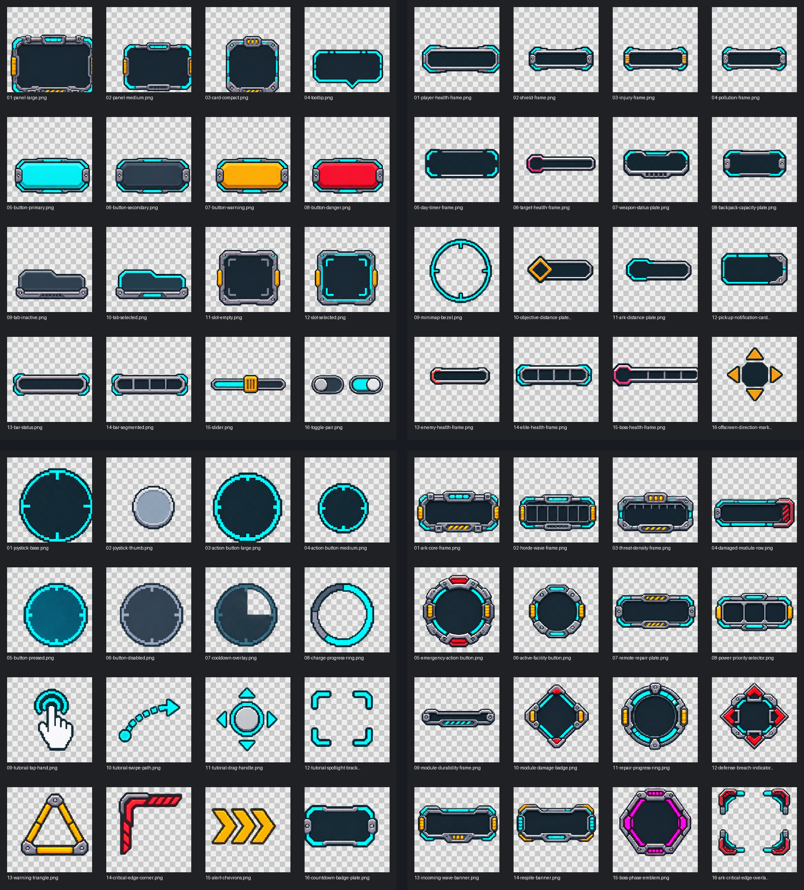
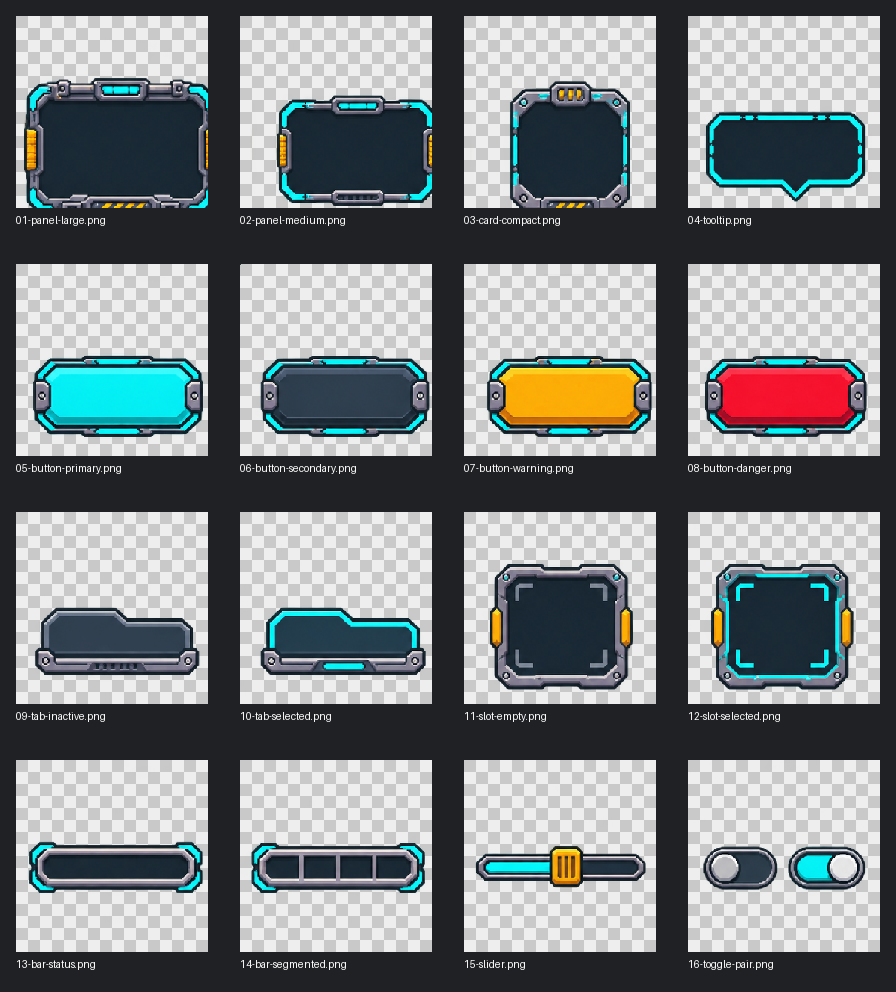
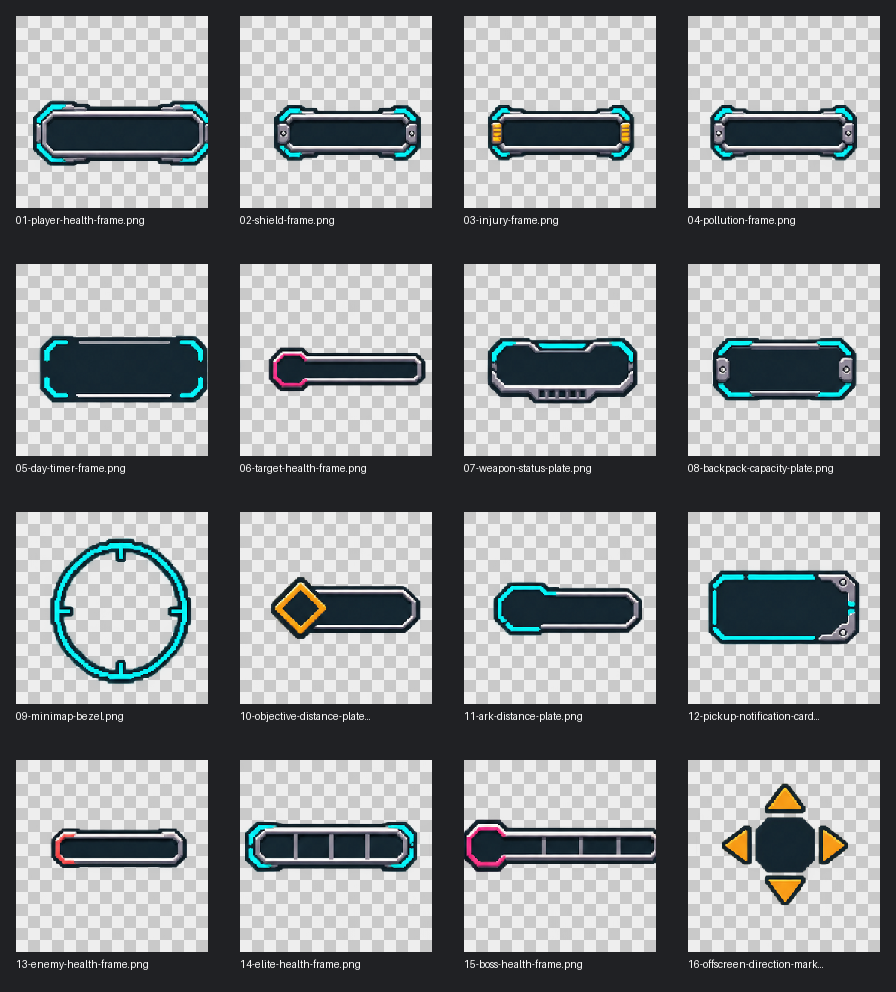
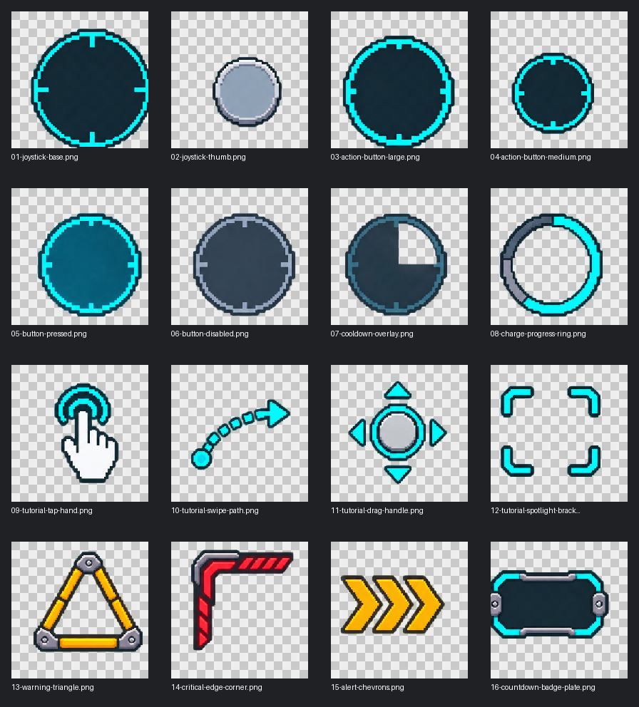
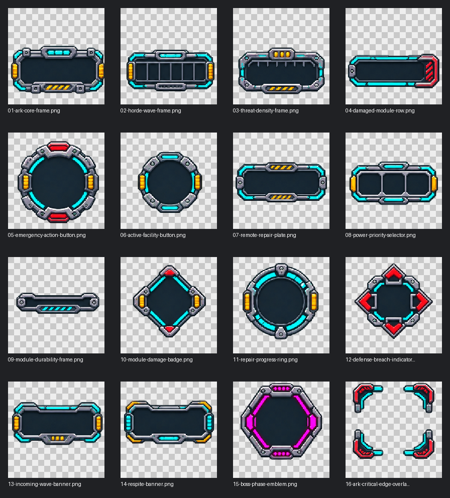

# 《无限进化：末日方舟》P0 UI 组件素材库

> 版本：1.0  
> 日期：2026-11-03  
> 状态：64 张组件候选素材已生成、切片并完成尺寸与透明通道检查

## 1. 覆盖范围

本批素材用于首章最小可玩闭环，覆盖通用组件、白天探索 HUD、移动触控与教学、夜间防守 HUD 四组，共 64 张 256×256 RGBA 透明切片。

- Cocos 运行时切片：`assets/bundle/gui/ui-p0/texture/`
- 生成母版：`docs/design/assets/ui-p0/source-sheets/`
- 带文件名接触表：`docs/design/assets/ui-p0/previews/`
- 结构化清单：`docs/design/assets/ui-p0/asset-manifest.json`
- 可重复切片脚本：`scripts/slice-ui-p0-components.ps1`

## 2. 预览

### 通用组件

### 白天探索 HUD

### 移动触控与教学

### 夜间防守 HUD

## 3. 接入规则

- 图标、文字、数字、角标和进度值不得烘焙到组件图中，使用 Cocos 原生节点叠加。
- 条形框的填充置于框体下层，通过 `Sprite.Type.FILLED` 或遮罩控制。
- 圆形按钮中心叠加已有 `docs/design/assets/ui-icons/icons/` 图标。
- 面板、按钮、横向卡片和横幅优先配置为九宫格，切边值需要在 Creator 中按单图复核。
- 像素素材使用最近邻采样，不生成 mipmap；避免非整数缩放造成像素边缘模糊。
- 触控热区独立于可见图片，主按钮按设计规范扩展 10–16 设计单位。

## 4. 当前验收状态

- 64/64 文件为 256×256 RGBA。
- 64/64 文件包含真实透明像素。
- 已检查四组接触表，并清理母版跨格产生的孤立边缘残片。
- 尚未在 Cocos Creator 的 1334×750、16:9～20:9 场景中进行九宫格、实际缩放和安全区验收，因此当前状态为“可接入候选”，不是最终发布确认。

## 5. 生成记录

- 生成工具：Codex 内置图像生成。
- 视觉参考：主玩法 UI、HUD 图标库、夜间方舟防守效果图。
- 统一限制：透明背景、无文字、无数字、无水印、无场景、组件中心留给程序图标与数据。
- 来源和商业发布复核状态见 `asset-manifest.json`。
