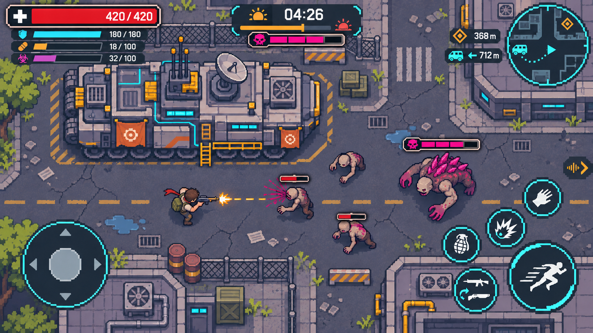

# 《无限进化：末日方舟》UI、画面、音频、引导与移动端体验策划案

> 文档版本：1.1
>
> 日期：2026-11-02
>
> 项目：InfiniteEvolutionDoomsdaySurvival
>
> 引擎：Cocos Creator 3.8.8 + Oops Framework
>
> 目标平台：抖音小游戏，横屏 1334×750
>
> 依据：《完整游戏策划案》《总览与设计支柱》《核心循环与局内结构》《世界地图与白天探索》
>
> 已确认方向：正交俯视平面精细像素、阶段自适应 HUD、固定双拇指触控

## 1. 文档目标

本案将项目已有的玩法规则转化为玩家可以看见、听见和操作的完整体验规范，供 UI、原画、像素美术、特效、音频、客户端和关卡团队共同执行。

所有体验设计必须服务于以下原则：

1. **风险可判断**：日落、返程、污染、伤势、供电和模块损坏都有持续且分级的反馈。
2. **阶段有差异、操作有连续性**：白天探索和夜间防守展示不同信息，但生命、移动、翻滚和技能的位置不改变。
3. **精美不牺牲可读性**：像素光影和尸潮氛围不能遮挡角色、特殊敌人、攻击预警和交互目标。
4. **反馈有层级**：普通拾取、精英击杀、方舟破损和章节迁徙使用不同强度的画面、声音和震动。
5. **移动端优先**：所有布局、字体、按钮、性能和音频决策先在真实手机横屏下验收。

## 2. 整体体验语言

### 2.1 核心关键词

- 末日工业
- 生物机械
- 精细像素
- 克制辉光
- 可判断的压迫
- 从残破到进化

### 2.2 视觉与听觉对立

| 阵营/状态 | 形状 | 主色 | 动态 | 音色 |
|---|---|---|---|---|
| 人类与方舟 | 直线、铆钉、模块化矩形 | 钢蓝、灰黑、科技青 | 稳定、机械节拍 | 金属撞击、电机、继电器 |
| 感染与尸潮 | 囊泡、触须、非对称曲线 | 暗红、洋红、腐紫 | 脉动、抽搐、蔓延 | 湿润组织、失真低吼、反向呼吸 |
| 风险与警告 | 三角、斜纹、断续边框 | 警戒橙、危险红 | 闪烁、收缩、倒计时 | 短促警报、重复脉冲 |
| 稀有进化 | 机械结构与有机脉络融合 | 青色与洋红并存 | 由冲突到同步 | 金属泛音叠加有机共振 |

### 2.3 色彩基线

| 用途 | 建议色 | 使用规则 |
|---|---|---|
| 深层背景 | `#081116` | 场景暗部与面板底，不直接用于正文文字 |
| 工业钢蓝 | `#31484F` | 方舟、建筑和普通 UI 框架 |
| 科技青 | `#64E0D2` | 可用、充能、友方、已连接 |
| 感染洋红 | `#D94B7D` | 污染、变异、感染者与生物进化 |
| 警戒橙 | `#E9933E` | 时间不足、噪音、即将发生的危险 |
| 危险红 | `#E04C4C` | 已发生的致命威胁，不与普通提示混用 |
| 正文浅灰 | `#D5DFDF` | 常规文字和图标 |
| 次级灰 | `#8EA0A7` | 说明、禁用和低优先信息 |

关键状态不能只靠颜色表达，必须同时改变图标、轮廓或运动方式。例如供电中断使用“红色＋断裂闪电图标＋间歇抖动＋停机音”。

## 3. 画面与美术规范

### 3.1 美术方向

采用“正交俯视平面精细像素”作为全部局内画面的统一语言。当前确认的主玩法 UI 图是整个项目的视觉基准：



- 摄像机使用正交高位俯视，能看见角色和怪物的头顶、肩部、武器方向与地面站位。
- 方舟展示顶部模块、炮塔、通风口和科技青能源线路，便于直接判断布局与损坏位置。
- 角色、怪物、方舟模块和可交互物保持清晰像素边缘，以扁平色块和 3–5 级明暗塑造体积。
- 空间层次依靠地面分区、屋顶边缘、投影和少量平面遮挡，不使用天空、地平线、透视汇聚或景深模糊。
- 辉光只用于能源、进化组织、危险预警和稀有奖励，不能覆盖整个画面；不采用 3A 材质和电影级体积光。
- 章节封面、结局图和关键角色档案允许使用精绘插画；常规战斗不混用高清插画角色。
- 当前模板 Loading 背景属于框架占位资产，与本案风格不一致，正式纵向切片前应替换。

### 3.2 像素技术框架

1. 以 **667×375** 作为像素美术逻辑画布，整数放大 2 倍得到项目参考分辨率 1334×750。
2. 常规角色使用约 32×40 至 40×52 px 的俯视包围框，头部直径约 10–14 px；巨型敌人和 BOSS 按机制需要突破该范围。
3. 像素资产使用最近邻采样，不使用双线性模糊；像素精灵默认关闭 Mipmap。
4. 物理移动可以连续计算，但渲染节点需做像素对齐，避免慢速移动时边缘抖动。
5. HUD 使用参考分辨率直接布局，不强制像素化文字；图标和装饰边框遵循 2 px 屏幕像素的整数网格。
6. 16:9 以外的设备按高度缩放并扩展左右视野，关键玩法和 HUD 始终位于安全区；不拉伸像素。

### 3.3 像素绘制标准

- 单个材质使用 3–5 级明暗，不依赖连续渐变塑造体积。
- 轮廓不统一使用纯黑，根据环境使用深蓝、深紫或深褐进行色相偏移。
- 金属使用短、硬、方向明确的高光；有机组织使用成片湿润高光和不规则暗部。
- 角色武器、头部和背部进化器官必须在实际游戏尺寸下可辨。
- 同职业敌人共享基础轮廓，特殊职能必须改变上半身、攻击器官或移动姿态。
- 普通小怪减少内部细节；精英和 BOSS 将细节集中到可破坏部位与机制提示。

### 3.4 场景层级

每个街区至少包含以下六层：

1. 道路、地砖、水面和污染区等地面底层。
2. 裂缝、标线、污渍、车辙和低矮杂物。
3. 建筑屋顶边缘、围栏、车辆、方舟和可碰撞设施。
4. 角色、怪物、掉落和交互物。
5. 弹道、攻击范围、天气和局部粒子。
6. 世界空间血条、方向提示和 HUD。

不使用横版远景视差。高墙、屋檐或方舟模块遮挡角色超过 25% 时应自动降透明度或显示角色青色轮廓，不允许为了氛围隐藏攻击预警。

### 3.5 光影与天气

- 白天：冷灰地面与建筑顶面保持较高明度；危险地点使用局部反差而不是整体压黑。
- 黄昏：地面和屋顶投影逐步拉长并转暖，环境明度下降，警戒橙成为主提示色；方舟方向出现稳定青色信标。
- 夜晚：方舟光源形成安全边界，尸潮侧使用低亮洋红轮廓；特殊感染者入场前先出现局部光影异常。
- 酸雨：绿色仅用于腐蚀层和水面反光，不改变全部 UI 色相。
- 高污染：从边缘加入脉动色差与低频噪点；中心瞄准、角色和按钮保持稳定。

闪光、色差和震屏均提供强度设置。最低档必须保留机制信息，但移除快速闪烁和大幅位移。

### 3.6 动画与战斗反馈

| 事件级别 | 适用事件 | 画面反馈 |
|---|---|---|
| 轻 | 普通射击、拾取、按钮 | 1–2 帧亮点、微缩放、轻粒子 |
| 中 | 弱点命中、技能、模块修复 | 短轮廓闪光、方向粒子、轻震屏 |
| 重 | 精英破防、爆炸、方舟受击 | 3–5 帧冲击、短停顿、明显震屏、残骸 |
| 章节 | BOSS 击杀、方舟进化、迁徙 | 分镜演出、环境换光、专属特效与音乐收束 |

命中停顿仅用于近战重击、精英破防和 BOSS 关键节点；持续射击不逐发停顿。屏幕震动驱动视觉相机，不改变角色和碰撞体位置。

### 3.7 首章纵向切片美术清单

- 玩家角色：待机、跑动、翻滚、受击、倒地、维修、双武器动作。
- 武器：步枪、霰弹枪及其枪口、弹道、命中和换枪反馈。
- 敌人：行尸、奔袭者、巨躯者、一个精英变体、屠夫母体。
- 方舟：基础车体、核心、机枪塔、装甲板、发电机、工坊及损坏状态。
- 场景：灰港街道、医院或警局室内、返程黄昏、夜战方舟阵地。
- UI：通用组件、探索 HUD、夜战 HUD、黄昏总览、背包、工坊、设置和引导遮罩。
- 特效：命中、弱点、拾取、污染、维修、供电、模块损坏、日落与尸潮预警。

先完成“一名角色＋一台方舟＋一种特殊感染者＋一组 HUD”的同屏风格标杆，经实际手机截图确认后再批量生产。

## 4. UI 与信息架构

### 4.1 UI 结构

采用“稳定外壳＋阶段替换区”的阶段自适应 HUD。

| 固定区域 | 白天探索 | 夜间防守 |
|---|---|---|
| 左上：角色生命与状态 | 伤势、污染 | 伤势、临时增益 |
| 顶部中央 | 白昼时间、日落阶段 | 波次、剩余威胁、喘息倒计时 |
| 右上 | 小地图、任务、方舟方向 | 方舟核心耐久、主攻方向 |
| 左下 | 移动摇杆 | 移动摇杆 |
| 右下 | 翻滚、技能、战术、互动、换枪 | 翻滚、技能、维修、设施、换枪 |
| 边缘指示 | 撤离、事件、高威胁敌人 | 受击模块、突破口、特殊感染者 |

阶段切换时，替换区域在 0.25–0.4 秒内完成图标重组并保留位置关联，不整屏淡出重载。

### 4.2 信息优先级

1. **立即致命**：角色濒死、方舟核心危险、不可回避攻击。
2. **需要马上处理**：特殊感染者、模块停机、极夜追猎、关键互动。
3. **持续风险**：日落时间、污染、噪音、供电余量。
4. **当前目标**：任务、返程方向、波次进度。
5. **背景信息**：资源变化、图鉴、新词条说明。

同一时刻最多展示一个一级警报和两个二级警报。低优先消息进入可展开的事件记录，避免提示互相覆盖。

### 4.3 探索 HUD

- 玩家主生命条使用高对比红色横条、白色医疗图标和明确数值，尺寸显著大于下方状态条。
- 护盾使用科技青，伤势使用警戒橙，污染使用感染洋红；三者采用更细、更暗的次级横条，保持固定顺序。
- 日落时间分为正常、黄昏警报、黑夜、极夜追猎四段，颜色、图标和声音同步变化。
- 小地图只显示已发现信息；地图边缘持续指示方舟和已标记目标。
- 背包接近满时在拾取信息旁提示剩余格数，不持续弹出窗口。
- 普通拾取自动进入简报；装备、蓝图和背包冲突才打开比较界面。
- 高威胁敌人首次出现时显示名称、职能图标和弱点提示，后续只保留职能图标。

### 4.4 夜战 HUD

- 顶部中央显示波次阶段和威胁密度，不使用不准确的“剩余敌人数”制造误导。
- 方舟核心耐久常驻；模块列表只显示损坏、停机或被攻击的条目。
- 供电按钮展开后进入短时战术模式：战斗不暂停，时间降至 35%，允许快速切换优先级。
- 喘息阶段自动放大维修与供电入口，战斗技能保持原位但降低视觉权重。
- 满血普通小怪不显示常驻血条；受伤或被锁定的普通敌人在头顶显示短红条。
- 特殊感染者在头顶显示分段洋红血条和精英图标；当前锁定目标在顶部中央同步显示紧凑目标血条。
- BOSS 使用阶段血条，但不能遮挡波次、方舟核心耐久和主要警报。

### 4.5 黄昏整备界面

黄昏采用一张可缩放的方舟剖面总览，底部固定六个主入口：

1. 总览：核心等级、电力、噪音、装甲、次夜情报。
2. 布局：模块槽、射界、供电线路和损坏状态。
3. 工坊：制造、强化、改装和拆解。
4. 研究：科技树、生化进化与副作用。
5. 成员：岗位、伤势、士气和任务。
6. 仓库：装备筛选、标签、方案和比较。

玩家从任一子页返回时保持方舟缩放位置和筛选条件。确认开战前提供“未修复关键模块、供电不足、空闲岗位”摘要，但不自动消耗稀有材料。

### 4.6 导航与弹层

- 使用界面栈管理：战斗 → 暂停 → 设置；黄昏 → 工坊 → 装备详情。
- 返回键只关闭最上层界面；不可一次退出多个层级。
- 阻断弹窗只用于永久选择、资源不足后的替代方案、退出和覆盖方案。
- 普通奖励、任务进度和资源变化使用非阻断提示。
- 所有界面打开时必须有明确默认焦点，以便未来接入键盘或手柄测试。

### 4.7 字体、图标与组件

- 标题、章节数字和大型计时可使用已授权的像素风中文字体。
- 正文、装备词条和长说明使用高可读无衬线中文字体，避免小字号像素汉字糊成方块。
- 1334×750 参考分辨率下，正文不低于 22 px；关键数值 28–36 px；一级标题 36–48 px。
- 文本缩放至 130% 时不裁切核心内容，列表和按钮由容器自适应。
- 图标先表达类别，再用角标表达状态；同一图标不承担两个相反含义。
- 主按钮使用实心科技青，危险确认使用警戒橙或危险红，禁用状态降低明度但仍保留文字对比。

### 4.8 UI 动效

- 常规按钮按下：缩放至 96%，70–90 ms；释放回弹 120–160 ms。
- 页面进入：主要内容 180–240 ms，禁止超过 400 ms 的频繁过场。
- 获得装备：图标定格、品质边框展开、关键词条依次出现；总时长不超过 1.2 秒且可点击加速。
- 警报：先给方向，再给文字；不得用全屏红闪持续覆盖战斗。
- 降低动态效果设置开启后，移除弹性回弹、视差位移和大范围扫光，保留状态切换。

## 5. 音频体验规范

### 5.1 总线结构

```text
Master
├─ Music
├─ Ambience
├─ SFX
│  ├─ Player
│  ├─ Enemy
│  └─ Ark
├─ UI
└─ Voice
```

所有声音必须进入对应总线。设置界面提供总音量、音乐、音效、环境和语音五个滑杆；滑杆以感知响度曲线映射到 dB，零值为静音。

移动端以代表性完整昼夜流程测量，目标综合响度约 **-18 LUFS（±2）**，Master 真峰值不高于 **-1 dBTP**。Master 限幅器只作为安全保护，不能替代正常混音。

### 5.2 动态音乐

音乐采用纵向分层为主、段落切换为辅：

| 状态 | 音乐层 |
|---|---|
| 安全探索 | 低频氛围、稀疏脉冲、远处金属声 |
| 发现威胁 | 加入低音节奏和不协和纹理 |
| 战斗 | 加入打击乐与短循环动机 |
| 黄昏返程 | 提升脉冲速度，加入方舟信标主题 |
| 夜战试探波 | 基础鼓点、方舟机械节拍 |
| 主攻波 | 低频、打击乐和感染音色逐层加入 |
| 喘息段 | 保留节拍骨架，移除高压层 |
| 高潮/BOSS | 专属动机、完整低频和机制重音 |

音乐层按威胁值、波次阶段和方舟核心状态平滑切换。常规层在小节边界切换，紧急警报和 BOSS 阶段使用短促 stinger 立即响应。

### 5.3 环境与空间

- 每章至少有一套地表、室内、地下和方舟环境床。
- 环境声承担路线提示：发电机、电梯、水流、尸巢和方舟信标都应有方向性特征。
- 室内减少远景声并增加近距离反射；进入房间时平滑切换，不瞬间静音。
- 极夜追猎降低环境细节，强化呼吸、脚步和远处追击声，形成注意力收束。

### 5.4 战斗音效

- 每种武器建立“机械动作＋发射主体＋尾音＋命中材质”四层结构。
- 同类脚步、枪声和命中使用 3–6 个样本池，并进行小幅音高和音量随机，避免机枪式重复。
- 特殊感染者拥有唯一预警音，进入玩家视野前 0.5–1.5 秒播放，并提供方向信息。
- 方舟核心、发电机、炮塔和装甲使用不同机械节奏；停机、过载和损坏可以只凭声音区分。
- 同屏大量敌人时合并低优先级普通音效，保留玩家、精英、BOSS、方舟警报和关键交互。

### 5.5 UI 音效

| 事件 | 音效特征 |
|---|---|
| 普通点击 | 短、干净的机械触点 |
| 确认/制造 | 继电器闭合＋短促上行音 |
| 取消/返回 | 柔和下行音，不使用错误蜂鸣 |
| 装备比较变好 | 清晰但克制的高频亮点 |
| 资源不足 | 两段式低频提示，不与致命警报同音色 |
| 进化完成 | 机械展开与有机共振融合 |

连续列表操作需要限制 UI 音效触发频率，滑杆拖动不逐像素播放声音。

### 5.6 Ducking 与可访问性

- 语音或关键机制播报触发时，音乐降低约 6–10 dB，300–500 ms 恢复。
- 方舟核心濒危时，非关键环境声降低约 6 dB，为警报和敌人预警让出频段。
- 提供“低动态范围”选项，缩小爆炸与环境底噪的响度差，适配手机扬声器和公共场合。
- 所有关键声音同时有视觉提示；字幕显示说话者、方向和非语音关键声，例如“【右侧】掘地声接近”。

## 6. 新手引导方案

### 6.1 引导目标

新玩家应在三分钟内理解：

1. 角色会自动攻击，玩家主要负责移动、目标优先级与技能。
2. 白天时间有限，搜刮后必须返回方舟。
3. 方舟是长期成长主体，也是夜晚必须保护的目标。

引导不追求一次教完系统，而是让玩家在真实需求出现前掌握下一项操作。

### 6.2 引导语法

每个教学单元遵循：

```text
安全展示 → 单一目标 → 玩家操作 → 即时反馈 → 在低压力下再用一次 → 放开限制
```

- 首次提示以世界目标、角色广播和局部高亮为主。
- 只有玩家连续两次未响应时才使用遮罩和指向手势。
- 玩家成功完成后不再重复强制提示，仅在帮助页保留回顾。
- 提示文字每屏只讲一个动作，正文尽量控制在两行内。
- 战斗中不出现需要阅读长文的装备、词条或进化说明。

### 6.3 第一章七日引导节奏

| 时点 | 新内容 | 教学情境 | 验收行为 |
|---|---|---|---|
| 第 1 天前 1 分钟 | 移动、自动射击 | 安全街区，单向低威胁敌人 | 玩家主动移动并让自动射击命中 |
| 第 1 天 1–3 分钟 | 搜刮、背包格、方舟方向 | 路边物资箱与一个支路 | 拾取资源并识别返程指示 |
| 第 1 天后段 | 日落与返程 | 黄昏警报，开放已知近路 | 在黑夜前返回方舟 |
| 第 1 夜 | 炮塔、维修、核心耐久 | 单方向基础尸潮 | 激活设施并完成一次维修 |
| 第 2 天 | 装备比较、伤势、污染 | 医疗点与污染箱二选一 | 看懂代价并做出选择 |
| 第 2 夜 | 供电与特殊感染者 | 炮塔短时停机，电磁敌人出现 | 切换供电并优先击杀目标 |
| 第 3 天 | 工坊、换枪、词条 | 制造一把霰弹枪 | 装备并在近距离使用 |
| 第 3 夜 | 多方向防守、喘息维修 | 两侧低密度波次 | 在喘息段处理受损模块 |
| 第 4–5 天 | 幸存者、尸巢、动态地图 | 救援与清巢支路 | 理解白天选择影响夜晚 |
| 第 5 夜 | 精英弱点 | 明确蓄力与可破坏部位 | 打断精英技能 |
| 第 6 天 | BOSS 削弱、方舟进化预览 | 废车与探测任务二选一 | 选择一种削弱方式 |
| 第 7 夜 | 综合检验 | 屠夫母体三阶段 | 独立完成配置、操作和重试 |

### 6.4 失败与补救

- 未在黄昏前返程：第一次触发低伤害追猎演示和明确撤离箭头，不立即重罚。
- 不会维修：模块进入危险状态后暂停刷怪 5 秒，维修按钮放大并播放定位音。
- 供电错误：保留上一次有效方案，提示“恢复推荐方案”，不强迫玩家重开。
- 连续两次失败同一机制：失败复盘直接指出“受到什么影响、可如何避免、下一次从哪里重试”。
- 玩家主动跳过教学：保留基础目标和风险提示，复杂系统仍按天数解锁，不用一次性开放全部菜单。

### 6.5 引导数据与复盘

引导步骤以数据配置，至少包含：触发条件、目标行为、成功条件、最大等待时间、提示升级、暂停策略、跳过策略和埋点 ID。UI 不直接修改玩法状态，只监听事件并发送明确的教学请求。

关键指标：

- 三分钟内完成移动、战斗、搜刮和返程认知的比例。
- 第一次日落时查看返程方向的比例。
- 第一夜首次维修成功所需时间。
- 第一次供电教学中的错误次数。
- 引导跳过率、提示升级率和第一章各日流失点。

## 7. 移动端体验规范

### 7.1 默认触控布局

采用固定双拇指区：

- 左侧：固定虚拟摇杆，只承担移动。
- 右侧主位：翻滚，作为最高频主动动作。
- 右侧扇形：主动技能、战术装置、互动/维修、换枪。
- 自动射击默认采用“有有效目标时射击”；玩家可切换持续射击。
- 点击高威胁敌人或其方向标可切换优先目标，不要求精确拖拽瞄准。

右侧按钮不因情境改变位置，只改变图标与可用状态；探索互动和夜战维修共享同一位置，保持肌肉记忆。

### 7.2 热区与自定义

- 主动作按钮直径为参考分辨率 104–120 px，次级按钮 80–96 px。
- 触控热区比可见图标向外扩展 10–16 px，但相邻热区不能重叠。
- 屏幕边缘预留系统手势和圆角安全区，关键按钮距离安全边缘至少 16 px。
- 支持整体 80%–140% 缩放、透明度、位置微调、左右手镜像和恢复默认。
- 编辑布局时显示拇指舒适区、冲突热区和安全区，不能把关键按钮拖到不可触达区域。

### 7.3 辅助战斗预设

作为可选方案提供：

- 条件满足时自动释放普通主动技能。
- 自动选择最近高威胁目标。
- 长按互动改为点击切换。
- 连续维修保持，不要求持续按住。
- 降低同时按键需求，不把闪避与技能设计为必须组合触发。

辅助预设不改变敌人数据、掉落或进度，仅减少操作负担。

### 7.4 屏幕与安全区

- 参考布局：1334×750，16:9。
- 验收比例：16:9、18:9、19.5:9、20:9，以及左右打孔/圆角安全区。
- 玩法视野按高度保持，宽屏扩展两侧；不得让宽屏玩家提前发现未激活敌人或绕过触发器。
- HUD 锚定安全区，不锚定物理屏幕边缘。
- 设备旋转被锁定为横屏；应用恢复时重新读取安全区和画布尺寸。

### 7.5 中断、暂停与恢复

- 进入后台、来电或系统弹窗时立即暂停单机战斗并静音。
- 回到前台先显示静态暂停层，玩家点击“继续”后倒计时 3 秒恢复。
- 白天、黄昏和夜间均保留可靠快照；不在伤害结算或模块拖动中间写完整存档。
- 网络异常不能阻断本地核心玩法；平台登录、广告或云能力失败应使用可恢复提示。
- 重新进入游戏时明确显示当前章节、天数、阶段和上次保存时间。

### 7.6 性能与热量预算

移动端性能优先级：输入响应 > 特殊敌人和攻击预警 > 角色/方舟动画 > 普通尸群细节 > 装饰特效。

| 档位 | 目标 | 降级策略 |
|---|---|---|
| 高 | 稳定 60 FPS | 完整平面阴影、天气、粒子和能源辉光 |
| 中 | 稳定 45/60 FPS | 降低地面装饰更新、粒子数量和动态光数量 |
| 低 | 稳定 30 FPS | 集群尸群、简化阴影、关闭次要扭曲和前景天气 |

- 战斗触控到角色响应目标低于 100 ms。
- 对象池覆盖敌人、弹道、伤害数字、掉落和常用特效。
- 普通尸群使用分级 AI 更新；屏外单位降低更新频率。
- 同屏伤害数字设置数量上限并按重要性合并。
- 连续 15 分钟完整昼夜流程后检查帧率、内存增长、电量与机身温度。
- 自动画质只在安全阶段调整，不在战斗中突然改变画面密度。

### 7.7 触觉反馈

- 普通射击默认不震动，避免持续耗电和麻木。
- 翻滚成功、重击命中、方舟模块破损和 BOSS 阶段转换使用不同短震模式。
- 所有震动可单独关闭；低电量或系统省电模式下自动降低强度。

### 7.8 可访问性设置

- 震屏强度：0%、25%、50%、100%。
- 闪光强度：关闭、降低、完整。
- 伤害数字：关闭、精简、完整。
- 字幕、关键声音字幕和说话者标识。
- 色弱符号增强，不只调整整体滤镜。
- 文字大小、按钮大小、左右手布局和辅助战斗预设。
- 长按/连点操作提供点击切换替代。

## 8. Cocos Creator 与现有项目的落地边界

### 8.1 UI 层级建议

沿用 Oops Framework 的 UI 配置与分层，不让玩法模块直接持有具体界面节点。建议在现有 `UIID` 基础上扩展：

- Loading
- Hall/Continue
- ExplorationHUD
- DefenseHUD
- DuskOverview
- Inventory
- Workshop
- Research
- Survivors
- Settings
- TutorialOverlay
- Pause
- Result

HUD 订阅角色、世界、方舟和战斗事件，只在数据变化时刷新，不在每帧主动读取全部状态。

### 8.2 事件边界

至少需要以下事件族：

- `PhaseChanged`
- `DayTimeChanged`
- `HealthChanged`
- `InjuryChanged`
- `PollutionChanged`
- `InventoryChanged`
- `ThreatChanged`
- `WaveChanged`
- `ArkCoreChanged`
- `ModuleStateChanged`
- `PowerChanged`
- `HighThreatDetected`
- `TutorialStepChanged`
- `AudioStateChanged`

事件携带稳定 ID 和显示所需的最小数据。UI、音频和引导可以同时响应同一玩法事件，但不能反向修改彼此状态。

### 8.3 资源与包体

- 首章按场景、角色、UI、音频拆分 Bundle，Loading 只加载启动必需资源。
- 长音乐和环境声使用流式或平台适合的压缩格式；短 UI 和战斗音效常驻或按音效组预载。
- 像素贴图按角色、敌人、方舟和场景分别制作图集，避免单张超大图集导致无关资源常驻。
- 中英文文本与纹理分离，UI 文本不烘焙进背景图。
- 所有正式资产记录来源、授权、版本、尺寸、帧数、锚点、压缩设置和验收状态。

## 9. 生产计划

### 阶段 1：风格标杆

以已确认的主玩法 UI 概念图为基准，在 Cocos Creator 中复现一张 1334×750 实机场景：玩家、俯视方舟、特殊感染者、分级血条、探索 HUD 与黄昏地面投影同屏。同步制作 10–15 秒音频样片，验证机械与感染音色的对立。

通过条件：手机实机下角色、危险方向、关键按钮和特殊敌人均能在一秒内识别。

### 阶段 2：灰盒体验

使用占位像素资产完成探索 HUD、夜战 HUD、固定双拇指操作、日落警报和第一日引导。验证布局、热区和信息层级，不等待完整美术。

通过条件：未阅读策划案的测试者能在三分钟内完成搜刮并理解返程。

### 阶段 3：第一可玩原型

接入动态音乐、特殊感染者预警、模块音效、黄昏整备和第一夜教学，形成完整“探索—整备—防守”闭环。

通过条件：普通一日流程 10–15 分钟，常规整备不超过 90 秒，失败原因可被玩家正确复述。

### 阶段 4：首章纵向切片

完成七日引导、灰港美术、屠夫母体演出、移动端画质档和全部可访问性设置。对真实设备进行性能、热量、音频和安全区测试。

通过条件：达到第 10 节全部验收标准后，才批量扩展其余章节资产。

## 10. 验收标准

### 10.1 画面

- 像素边缘在 1334×750 和主流宽屏设备上保持清晰，无非整数拉伸模糊。
- 玩家、特殊感染者、可交互物和攻击预警在大规模尸潮中可辨。
- 青色、洋红、橙色分别稳定表达科技、感染和警戒，不发生语义混用。
- 最低特效档仍保留机制提示和受击方向。

### 10.2 UI

- 白天与夜晚切换后，固定操作位置不变。
- 所有关键 UI 位于系统安全区内，20:9 设备无裁切或不可触达按钮。
- 文本放大至 130% 后，关键按钮、数值和说明不重叠。
- 玩家可在两次点击内从警报定位到对应模块或目标。
- 普通拾取、资源变化和低优先信息不阻断移动与战斗。

### 10.3 音频

- 特殊感染者在进入视野前有可辨且有方向的预警声。
- 语音、机制警报和方舟濒危提示不会被音乐或尸潮声掩盖。
- 音乐切层不爆音、不明显跳拍，喘息段与高潮段存在清晰差异。
- 手机扬声器、耳机和低动态范围模式下均能区分玩家、敌人与方舟关键音效。

### 10.4 引导

- 新玩家三分钟内理解自动射击、搜刮和返程。
- 第一夜能独立完成一次炮塔使用和模块维修。
- 第三夜前理解供电、换枪和喘息维修。
- 失败复盘能够指出具体机制和可执行的下一步，而不是只显示“挑战失败”。

### 10.5 移动端

- 主按钮误触率和漏触率处于可接受范围，连续 15 分钟操作不产生明显拇指疲劳。
- 后台恢复、来电中断、重启和网络异常不会丢失关键进度。
- 目标低端设备在降级方案下保持稳定 30 FPS 和可接受的触控延迟。
- 画质降低不改变敌人数值、掉落、攻击预警或判定公平性。

## 11. 明确不采用

- 不使用怀旧 8-bit 大颗粒风格作为正式画面。
- 不使用全阶段固定且信息全部常驻的拥挤 HUD。
- 不使用随情境漂移位置的核心战斗按钮。
- 不依赖全屏变色、持续震动或高频闪烁表达危险。
- 不在前三分钟教学背包词条、方舟布局、研究和幸存者等复杂系统。
- 不把关键提示只做成语音、颜色或震动中的单一通道。
- 不为了高端设备效果牺牲低端设备上的输入响应和机制可读性。

## 12. 最终设计结论

本项目的表现目标不是单纯复古，也不是像素化 3A 写实，而是利用正交俯视、扁平像素色块和清晰轮廓获得可控资产量与鲜明身份，再以状态色、平面层级、动态音乐和分级反馈建立现代精品感。

最终体验应让玩家在手机横屏上始终清楚三件事：

1. **我现在面临什么危险。**
2. **我能立刻做什么。**
3. **这次选择将如何影响方舟和下一阶段。**

只要画面、UI、声音、引导或移动端设计无法强化这三项认知，就应减少、重做或移出首发范围。
